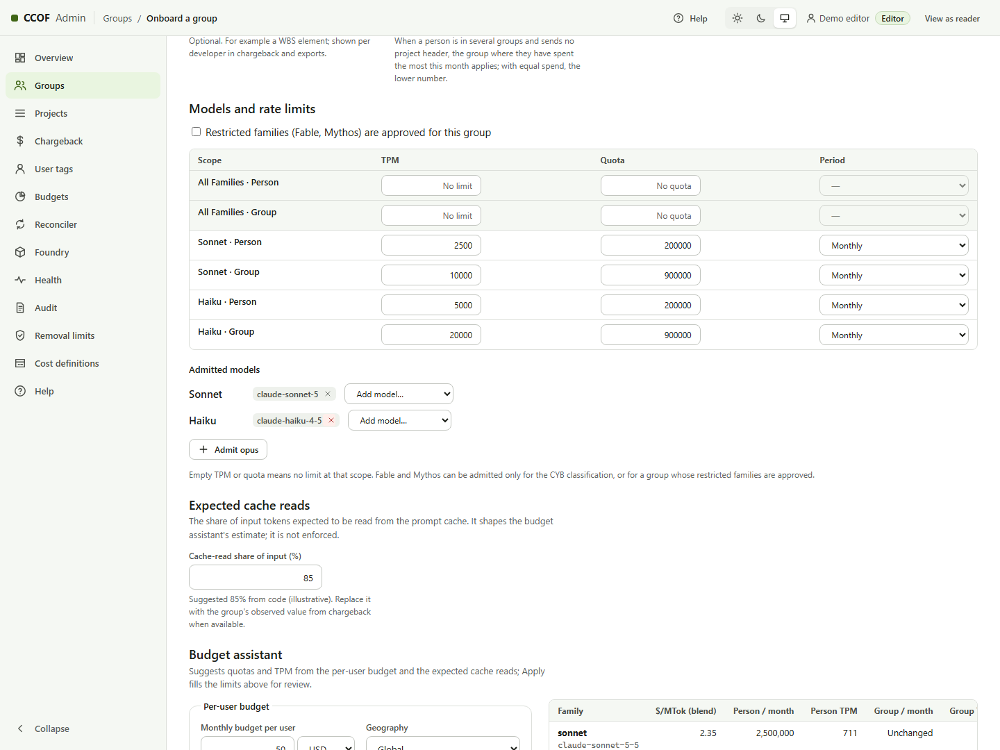

# Staged deployment guide

> **Short path:** [Get started](get-started/01-what-it-is.md) gives the same stages as steps with the expected output
> and a screenshot for each. This page is the full reference: every setting, the Portal way of each stage, and the
> evidence of the live runs.

This guide deploys CCOF (Claude Code on Foundry) in nine stages, 0 to 8, and then onboards Entra
groups. Each stage has a **Cloud Shell** way (one script command) and a **Portal (UI)** way (the
equivalent screens), and the same configuration file drives both. Every stage previews first and
changes nothing until it is run with `-Apply`.

**Safety:** Stage 0 reads Azure/Graph but writes local evidence. A preview is not a deployment or an
acceptance pass. Stage 8 with `-Apply` makes billable model calls. Do not run all stages in a loop:
review each preview and obtain the next owner's approval first. Use a new resource group, prefix and
state directory for a lab; never point an experiment at an existing workload.

| Part | Contents |
| --- | --- |
| [1. What gets deployed](#1-what-gets-deployed) | Components and the order of the stages |
| [2. Prerequisites](#2-prerequisites) | People and roles, network, Entra applications, Graph permissions, Foundry models |
| [3. Cloud Shell setup](#3-cloud-shell-setup) | Source code, sign-in, configuration file |
| [4. Stages 0 to 8](#4-stages-0-to-8) | Per stage: purpose, who, Cloud Shell command, Portal steps, how to check it |
| [5. Onboard groups](#5-onboard-groups) | Admin console steps after Stage 8 |
| [6. Optional features](#6-optional-features) | Group search, surface enforcement, Power BI export |
| [7. Rerun, rollback and cleanup](#7-rerun-rollback-and-cleanup) | |
| [8. References](#8-references) | |

Detailed background for each stage is in the [staged deployment runbook](runbooks/STAGED-DEPLOYMENT-V2.md)
and the [Portal workbook](runbooks/AZURE-PORTAL-DEPLOYMENT.md). This guide is the short path through them.

---

## 1. What gets deployed

| Component | Azure resource | Role |
| --- | --- | --- |
| Gateway | API Management (Standard v2) | Validates the caller's Entra token, asks the resolver who may call what, applies limits, forwards to Foundry, writes usage telemetry ([GATEWAY.md](GATEWAY.md)) |
| Resolver | Function App (Flex Consumption) | Turns a person into an entitlement decision: group, models, limits, surfaces, budget state |
| Sync | Function App | Reads Entra group membership and writes each person's entitlement document ([SYNC.md](SYNC.md)) |
| Reconciler | Function App | Prices usage at the rate card and writes budget state ([COST-MODEL.md](COST-MODEL.md)) |
| Admin console | Function App | Onboards groups, sets budgets and limits, shows chargeback, exports ([ADMIN-V3.md](ADMIN-V3.md)) |
| Registry | Cosmos DB (capacity mode chosen in section 2.6) | Group documents, entitlements, budget state, admin change record |
| Telemetry | Log Analytics, Application Insights, workbook | Usage ledger and the chargeback workbook ([CHARGEBACK.md](CHARGEBACK.md)) |
| Models | Microsoft Foundry account with Claude deployments | Existing or created by Stage 1 |

Stage order and what each one needs:

```text
0 preflight ─▶ 1 resources ─▶ 2 schema ─▶ 3 grants ─▶ 4 Entra ─▶ 5 configuration ─▶ 6 network ─▶ 7 code and data ─▶ 8 acceptance ─▶ onboard groups
  read-only     Azure only     Azure only   RBAC        Graph       Azure only           VNet          needs the VNet       model calls      admin console
```

Stages 2 to 5 do not need the network, so the network team can build it while they run. Stage 7 needs
a verified Stage 6, because the apps reach their private storage and Cosmos only through the VNet
([runbook](runbooks/STAGED-DEPLOYMENT-V2.md), "Stages and permission boundaries").

---

## 2. Prerequisites

Before opening Cloud Shell, have the owners tick this checklist:

- [ ] **Platform:** approved tenant, subscription, region, new resource group/prefix, cost approval,
  source revision and a private configuration/state location; PowerShell 7.2+, Azure CLI, Bicep,
  Node.js/npm and Git available.
- [ ] **Identity:** Stage 4 application/group owner available with active PIM roles; three app
  registrations approved, pilot security-group members and at least one admin editor identified.
  Azure subscription Owner does **not** confer Entra application administration or Graph consent.
- [ ] **Access:** Stage 3 Azure RBAC/Cosmos role writer identified separately from the optional
  Graph-consent administrator. Activate only the role needed for the current stage.
- [ ] **Models:** approved existing deployments and network reachability, or permission to purchase
  the Marketplace offer and create them. Listing a model is not proof of purchase eligibility,
  quota/capacity, or a successful inference.
- [ ] **Network:** subnet IDs, DNS ownership, endpoint approval and egress agreed with the network
  team; an approved connected runner can reach the private app endpoints for Stage 7/8.
- [ ] **Handoff:** admin editor and a direct pilot-group member available to verify access.
  Decide whether optional Graph grants are approved; otherwise leave directory-search flags and
  the sync timer off and use the delegated snapshot.

### 2.1 People and roles

Several people can share the work; each stage names who runs it.

| Stage | Who | Least role that works |
| --- | --- | --- |
| 0 | Platform engineer | Reader on the subscription, resource group and Foundry accounts; directory read of groups |
| 1 | Platform engineer | Contributor on the resource group, and `Microsoft.Resources/resourceGroups/write` on the subscription to create it. Marketplace purchase rights if Stage 1 creates Claude deployments |
| 2 | Platform engineer | Contributor on the Cosmos DB account |
| 3 | Access administrator | Role Based Access Control Administrator (or Owner) on the resource group, the Cosmos account and each Foundry account |
| 4 | Entra administrator | Application Administrator (or owner of existing apps) and Groups Administrator (or owner of existing groups) |
| 5 | Platform engineer | Website Contributor on the Function Apps, API Management Service Contributor, workbook write |
| 6 | Network team | Reader (verify mode). Network Contributor and Private DNS Zone Contributor in `existing`/`create` modes |
| 7 | Platform engineer | Website Contributor (publish); delegated read of the registered groups |
| 8 | Platform engineer | A gateway caller identity in an onboarded group; Log Analytics Reader |
| Graph grants (section 6.1) | Privileged Role Administrator or Global Administrator | Tenant-wide admin consent for application permissions |

Source: [runbook permission table](runbooks/STAGED-DEPLOYMENT-V2.md) and [PERMISSIONS.md](PERMISSIONS.md).

### 2.2 Network

The default (`network.mode: verify`) expects the customer's network team to build the network and has
Stage 6 check it without changing it. In `existing` mode Stage 6 uses the customer's subnets and DNS
zones and creates only the private endpoints, DNS zone groups and VNet integrations. In `create` mode
(labs) it also creates the VNet, subnets, NSG and DNS zones
(stage6-network.bicep; [NETWORK.md](NETWORK.md)).

| Item | Requirement |
| --- | --- |
| Virtual network | One VNet in the deployment region (a region where Flex Consumption is available) |
| Functions subnet | Delegated to `Microsoft.App/environments`; used by all four Function Apps for outbound VNet integration |
| Private endpoint subnet | No delegation; holds every private endpoint |
| APIM subnet | Delegated to `Microsoft.Web/serverFarms`, with an NSG; used by Standard v2 APIM outbound VNet integration |
| Private endpoints | Cosmos DB (`Sql`), each Function App's storage account (`blob`), each private Foundry account (`account`) |
| Private DNS zones | `privatelink.documents.azure.com`, `privatelink.blob.core.windows.net`, and for Foundry `privatelink.cognitiveservices.azure.com`, `privatelink.openai.azure.com`, `privatelink.services.ai.azure.com`; each linked to the VNet, with a DNS zone group on each endpoint |
| Outbound from the Function Apps | HTTPS to Microsoft Entra ID, Microsoft Graph, Log Analytics and Application Insights (Azure Monitor). VNets created after 2026-03-31 have no default outbound access, so a NAT gateway or firewall provides it ([network.bicep](../infra/prereqs/network.bicep)) |
| APIM subnet NSG | Microsoft's minimum rules for APIM VNet integration. Inbound: Internet 80/443, `ApiManagement` 3443, `AzureLoadBalancer` 6390, `AzureTrafficManager` 443. Outbound: Internet 80 (certificate validation), `Storage` 443, `SQL` 1433, `AzureKeyVault` 443, `AzureMonitor` 443 and 1886 ([network.bicep](../infra/prereqs/network.bicep)) |
| Outbound from the operator's shell | HTTPS to Azure Resource Manager, Microsoft Graph, GitHub and the npm registry |

Stage 6 does not test firewall or route-table (UDR) egress. A missing egress path shows up later as a
Stage 7 or Stage 8 failure.

Cloud Shell runs on a public host. It can deploy and verify configuration, but it cannot test private
DNS resolution or routing from inside the VNet ([CLOUD-SHELL-QUICKSTART.md](runbooks/CLOUD-SHELL-QUICKSTART.md)).

### 2.3 Entra applications

Stage 4 creates these registrations, or merges settings into existing ones named in `entra.existing`
(infra/staged/Staged.Entra.ps1). The table lists what each one
needs, so an Entra administrator can also create them by hand (Portal path: **Microsoft Entra ID →
App registrations**).

| Application | Purpose | Settings Stage 4 applies |
| --- | --- | --- |
| **CCOF Gateway** (developer sign-in) | The audience of a developer's token, and the client that signs developers in | Application ID URI `api://<appId>`; access tokens v2; delegated scope `access_as_user`; public client redirect URIs `http://localhost` and `ms-appx-web://microsoft.aad.brokerplugin/<appId>`; "Allow public client flows" on; preauthorizes itself (and Azure CLI when `entra.allowAzureCliClient` is true) |
| **CCOF Resolver API** | Audience of the token APIM's managed identity presents to the resolver | Application ID URI `api://<appId>`; access tokens v2; no redirect URIs, no secrets |
| **CCOF Admin** | The admin console (single-page app) and its API | Delegated scope `Projects.Manage`; app roles `CCOF.Projects.Read` and `CCOF.Projects.Write` (users); SPA redirect URIs `https://<admin-app>.azurewebsites.net/api/console` and `/api/console-v3`; "Assignment required" on; preauthorizes itself; editors and readers from `entra.adminEditors`/`adminReaders` are assigned their role |

No application secret is created. APIM and the Function Apps use managed identities.

#### Entra administrator: short Portal checklist

1. **Microsoft Entra ID → Overview:** confirm the directory, then **App registrations → New
   registration → Accounts in this organizational directory only**. Use three distinct registrations
   from the table. Record each **Application (client) ID**, **Directory (tenant) ID** and app
   **Object ID** privately; these are different from **Enterprise applications → Object ID**.
   Managed-identity principal IDs are service-principal Object IDs, not client IDs.
2. **Gateway → Expose an API:** set `api://<gateway-client-id>`, add enabled delegated
   `access_as_user` (users/admins can consent), and authorize the gateway's own client ID for that
   scope. Add Azure CLI only when `entra.allowAzureCliClient` is approved. **Authentication → Add
   a platform → Mobile and desktop applications:** add the localhost and broker redirects in the
   table; enable public client flows. The developer public client and gateway API are deliberately
   **one registration**, not a fourth SPA or a confidential client.
3. **Resolver → Expose an API:** set `api://<resolver-client-id>`; no developer redirect or secret.
   Stage 5 sets Function App **Authentication** to require Entra authentication and return `401`,
   accepts the resolver URI/client-ID audiences, and restricts **both** allowed client application
   and principal to APIM's managed identity. A correct audience alone must not admit other callers.
   Do not put the gateway developer client in the resolver allowlist
   ([app-settings.bicep](../infra/quickstart/modules/app-settings.bicep)).
4. **Admin → Expose an API:** set `api://<admin-client-id>`, add `Projects.Manage`
   (admins consent), authorize the admin app itself. **Authentication → Single-page application:**
   register the exact HTTPS URLs in the table, using Stage 1's admin hostname; do not put these
   redirects under Web or Mobile/desktop. **App roles:** create the two enabled roles with
   **Users/Groups** member type and the exact values shown. **Enterprise applications → the admin
   application → Properties:** set **Assignment required? Yes**; **Users and groups:** assign
   named editors/readers to the matching role. An Azure Contributor role is not a console role.
5. For each registration, use the **Manifest** to confirm
   `api.requestedAccessTokenVersion: 2`. Preview Stage 4 before applying; it creates service
   principals and merges registration settings, assignments and group members. If the identity team
   supplied apps, set `entra.existing.gatewayAppId`, `resolverAppId`, `adminAppId` to their **client**
   IDs and arrange change approval/ownership: `-Apply` is **not** a read-only import.

Stage 4 needs verified Stage 1 outputs to calculate the admin redirects. New admin apps require
`entra.adminEditors` (object IDs, or `@me` for the operator); `adminReaders` is optional. Prefer
explicit object IDs for a multi-person handoff. Stage 4 does not grant the managed identities Graph
application permissions. These are separate from the delegated gateway/admin scopes
(Staged.Entra.ps1;
[Learn: expose an API](https://learn.microsoft.com/en-us/entra/identity-platform/quickstart-configure-app-expose-web-apis);
[Learn: SPA registration](https://learn.microsoft.com/en-us/entra/identity-platform/scenario-spa-app-registration)).

**Groups.** Each team that uses Claude is an existing Entra **security** group, created by the
customer's identity team (Portal: **Microsoft Entra ID → Groups → New group**, type Security). The
sync reads **direct** members only; nested groups are not expanded ([SYNC.md](SYNC.md)). The pilot
group is seeded by Stage 7; additional groups are onboarded in the admin console after Stage 8
([section 5](#5-onboard-groups)). The staged
configuration's `groups` list holds the pilot group used by the Stage 8 acceptance test. In the
example it is a group entry (`"kind": "group"`): its own budget, models, surfaces, priority and
chargeback ID, with no project or classification ([section 3.3](#33-configuration-file)).

### 2.4 Microsoft Graph application permissions

Granted to managed identities by a Privileged Role Administrator or Global Administrator, after
Stage 1 has created the identities. None is required to finish Stages 0 to 8.

| Identity | Permission | Why | Needed when |
| --- | --- | --- | --- |
| Sync | `GroupMember.Read.All` | Read the direct members of onboarded groups | The sync timer is turned on (`sync.mode: application-permission`). Without it, Stage 7 loads members from a delegated snapshot |
| Sync | `User.Read.All`, `Application.Read.All` | Detect disabled and deleted members | Same |
| Admin | `User.Read.All` | Show names beside object IDs (`admin.userNamesEnabled`, which sets `ADMIN_USER_NAMES_ENABLED=true`) on the User tags page and Developers view | Optional ([ADR-0032](adr/0032-admin-directory-user-labels.md)) |
| Admin | `Group.ReadBasic.All`, `GroupMember.ReadBasic.All` | Search Entra groups and show the member count when onboarding (`admin.groupSearchEnabled`) | Optional; without it the admin pastes the group's Object ID ([ADMIN-API.md](ADMIN-API.md)) |

Least-privilege sources: [List group members](https://learn.microsoft.com/en-us/graph/api/group-list-members?view=graph-rest-1.0)
and [List groups](https://learn.microsoft.com/en-us/graph/api/group-list?view=graph-rest-1.0). The
grant helper is in [section 6.1](#61-graph-grants-group-search-names-and-sync).

### 2.5 Foundry models

Either an existing Foundry account with Claude deployments (listed under `backends`), or Stage 1
creates one (`stage1.foundry.create: true`), which requires a subscription that can purchase the Claude
offer from Azure Marketplace. A sandbox subscription cannot ([run report](archive/STAGED-STDV2-RUNS-2026-10-20.md)).

### 2.6 Cosmos DB redundancy

Every component uses one Cosmos DB account. The example configuration makes it redundant
([ADR-0036](adr/0036-cosmos-redundancy-and-consistency.md)):

| Setting | Example | Effect |
| --- | --- | --- |
| `stage1.cosmosCapacityMode` and `cosmos.capacityMode` | `provisioned`, `provisioned-autoscale` | Required for more than one region: a serverless account runs in one region |
| `stage1.cosmosLocations` | `eastus2` then `centralus`, both `isZoneRedundant: true` | Regions in failover order; the first is the write region and must be `location`. Two or more turn on service-managed failover |
| `stage1.cosmosConsistency` | `{ "defaultConsistencyLevel": "Session" }` | Data loss window on a region failover: under 15 minutes for Session; `BoundedStaleness` needs at least 100,000 writes or 300 s across regions; `Strong` loses none but adds cross-region latency to every write |

What each layout survives:

| Layout | Datacentre (zone) failure | Region outage |
| --- | --- | --- |
| No `cosmosLocations` (one region, the earlier default) | No | No |
| One region, `isZoneRedundant: true` (serverless allowed) | Yes | No |
| Two regions with service-managed failover | No, unless zone-redundant | Reads continue from the second region at once (the resolver reads in `COSMOS_PREFERRED_REGIONS` order, set by Stage 5); writes resume after failover |
| Two zone-redundant regions (example) | Yes | As above |

Choose a second region with availability zones and Cosmos capacity in your subscription. Stage 1 is create-only:
an account already deployed keeps its layout; a new layout needs a new resource group. Provisioned throughput is
billed in every region. Zone-redundant regions are charged a premium, which is waived for autoscale throughput, the
mode used here ([reliability, Cost](https://learn.microsoft.com/en-us/azure/reliability/reliability-cosmos-db);
[pricing](https://azure.microsoft.com/pricing/details/cosmos-db/)).

Region capacity is per subscription and changes over time. A live check on 2026-10-23 (lab subscription, a
Cosmos-only Bicep file with the same `locations` shape as `main.bicep`, not a full Stage 1 run) gave:

| Requested layout | Result |
| --- | --- |
| `eastus2` zone-redundant + `centralus` zone-redundant | Refused: `ServiceUnavailable`, "high demand in East US 2 region for the zonal redundant (Availability Zones) accounts" |
| `eastus2` + `centralus` zone-redundant | Refused: `ServiceUnavailable`, "high demand in this region East US 2" |
| `centralus` zone-redundant + `westus3` zone-redundant | Account created in `centralus` only; the deployment failed on `westus3` ("high demand … zonal redundant") |
| Same account, `westus3` without zone redundancy | Succeeded; `Get-StgCosmosAccountProblems` (the Stage 1 read-back function, called directly) returned no problems |

When ARM refuses a region, Stage 1 stops with the ARM error (`az deployment group failed: … ServiceUnavailable`)
and does not record the stage as complete. The account can exist with fewer regions than configured; for such an
account the read-back function returns "Cosmos has 1 region(s); the configuration has 2". The ways forward are a
region access request at <https://aka.ms/cosmosdbquota>, or another region or `isZoneRedundant` value, followed by
Stage 1 with `-Apply` again. When the resource group holds resources from the failed attempt, that rerun runs a
what-if first and refuses any Delete and any Modify of a resource the earlier attempt did not record; it can still
create resources (Staged.Resources.ps1, `Invoke-Stage1`).

---

## 3. Cloud Shell setup

Azure Portal → **Cloud Shell** (top bar) → **PowerShell**.

### 3.1 Source code

```powershell
$repo = '<repository-url>'       # the Git URL of this repository
cd $HOME
if (-not (Test-Path ccof)) { git clone $repo ccof }
cd $HOME/ccof
git pull --ff-only
npm ci --ignore-scripts --include=dev
```

Expected: `npm ci` finishes without errors. The group-centric version described here is not in the
public `naveenneog/ccof-bicep` repository, whose history ends before ADR-0034.

### 3.2 Sign-in and subscription

```powershell
$tenant = '<tenant-id>'          # Microsoft Entra ID > Overview > Tenant ID
$sub    = '<subscription-id>'
az account set --subscription $sub
az account show --query "{tenant:tenantId, subscription:id, user:user.name}" -o table
```

Expected: the target tenant and subscription. Cloud Shell drops variables after a timeout; this
block is pasted again after a reconnect.

### 3.3 Configuration file

```powershell
New-Item -ItemType Directory -Force $HOME/ccof-private | Out-Null
Copy-Item infra/staged/staged.config.example.json $HOME/ccof-private/staged.config.json
code $HOME/ccof-private/staged.config.json
$cfg = "$HOME/ccof-private/staged.config.json"
```

Replace every applicable `REPLACE-` placeholder; the driver validates selected fields, not every
unused example value. Review the entire file before applying. The sections, and the
stages that read them, are listed in the [runbook](runbooks/STAGED-DEPLOYMENT-V2.md#configuration-file).
Settings added for group onboarding:

| Key | Default | Meaning |
| --- | --- | --- |
| `groups[]` with `"kind": "group"` | example pilot | An Entra group onboarded as its own entity: `groupDisplayName` (Stage 4 creates or reuses it) or `groupId`, `members`, `displayName`, `backendId`, `priority`, `chargebackId` (or `null`), `budget` (`autoScale` with `groupCap: null`, or `cap` with a cap), `restrictedFamiliesApproved`, `familyPolicy`, `surfaces`, `cacheProfile`. No `projectId` or `classification`. Stage 7 seeds it as a group document; the sync app's `registrySeed` function checks it against the group contract ([group-registration.ts](../src/contracts/group-registration.ts)) and writes nothing if it fails. Entries with `projectId` and `classification` keep the earlier project model |
| `client.group` | `CCOF-PILOT01` | The group entry (by `groupDisplayName` or `groupId`) the developer client file is written for, with `client.models`. The client sends the group's object ID as the project selector |
| `client.signInMethod` | `msal` | `msal` or `azure-cli`. Stage 7 writes it into `client-config.json` and `onboarding.json`; `azure-cli` needs `entra.allowAzureCliClient: true` in Stage 4, otherwise Stage 7 stops with `client_sign_in_invalid`. Used with `client.group` ([section 6.6](#66-azure-cli-developer-sign-in)) |
| `acceptance` | no `project` | Stage 8 requests without a project selector, and checks in the usage trace that every request was charged to the pilot group. With more than one group entry, `acceptance.expectedGroup` names the expected one (`groupDisplayName` or `groupId`) |
| `admin.groupSearchEnabled` | `false` | Sets `ADMIN_GROUP_SEARCH_ENABLED` on the admin app (Stage 5). Requires the admin Graph grants in section 6.1; without them the admin API answers `502 group_directory_permission_required`. Ignored when `stage1.includeAdmin` is `false` |
| `admin.userNamesEnabled` | `false` | Sets `ADMIN_USER_NAMES_ENABLED` on the admin app (Stage 5): people's names beside object IDs (User tags page, Developers view). Requires the admin identity's `User.Read.All` (section 6.1); without it the console shows object IDs only |
| `resolver.usageGroupTotals` | `false` | Whether `/usage` also shows the person's group (scope) total. Stage 5 writes `RESOLVER_USAGE_GROUP_TOTALS` ([USAGE.md](USAGE.md), "Privacy") |
| `resolver.budgetEnforcement` | `token-limits-only` | Example compatibility mode: enforces token/rate limits, **not a dollar budget**. Use `budget-state` only after reviewing the reconciliation/accounting tradeoff below |
| `resolver.requireCompleteUsage` | `false` | Stage 5 writes `RESOLVER_REQUIRE_COMPLETE_USAGE`. Optional fail-closed accounting check; `true` requires `budgetEnforcement: budget-state`, otherwise configuration is refused |
| `reconciler.budgetGuard` | `{ "warnPercent": 80, "overshootPercent": 5, "projectionMinutes": 5 }` | Budget guard ([ADR-0040](adr/0040-budget-guard.md), section 6.5): warns the person at `warnPercent` of projected spend and slows requests from there; limits the spend rate so that the spend the reporting lag hides stays near `overshootPercent` of the budget. Takes effect with `resolver.budgetEnforcement: budget-state`. Absent: no guard. Stage 5 writes `RECONCILER_BUDGET_WARN_PERCENT`, `RECONCILER_OVERSHOOT_PERCENT`, `RECONCILER_PROJECTION_MINUTES` |
| `gateway.admission.usage` | 10 per 60 s | Per-person limit of `GET /ccof/me/usage`, separate from the `/v1/messages` limit |
| `gateway.surfaceClients` | `[]` | `[{ "clientAppId": "<guid>", "surface": "code" }]`: maps a client application to `chat`, `code`, `cowork`, `design` or `m365`. Empty means surfaces are not enforced. Each client must be admitted by the gateway. In the staged path the admitted clients are the CCOF Gateway app (Stage 4) and, when `entra.allowAzureCliClient` is `true`, Azure CLI (`04b07795-8ddb-461a-bbee-02f9e1bf7b46`) (Staged.Application.ps1). Any other client ID stops Stage 5 with `render_failed` and the message "`<id>` is not in delegatedClientAppIds or testIdentities.clientAppIds" ([config.ts](../infra/gateway/config.ts)) |

The state of each stage is written next to the configuration file in `.staged-state/state.json`. One
state folder belongs to one tenant, subscription and resource group.

The common command, shown for Stage 1 (the stage number changes per stage):

```powershell
pwsh -File infra/staged/Invoke-StagedDeployment.ps1 -Stage 1 -ConfigPath $cfg            # preview
pwsh -File infra/staged/Invoke-StagedDeployment.ps1 -Stage 1 -ConfigPath $cfg -Apply     # change, then verify
```

A stage that fails its read-back stops with `verify_failed: <reason>` and records nothing, so it can be
run again after the cause is fixed.

---

## 4. Stages 0 to 8

### Quick stage-by-stage commands

Run from the repository root after setting `$cfg` in section 3. Keep the same private `$stateDir`
for this target; never reuse another deployment's state. The second command below is a deliberate
write/approval boundary, not a command to paste automatically:

```powershell
$run = Join-Path $PWD 'infra/staged/Invoke-StagedDeployment.ps1'
$stateDir = Join-Path (Split-Path $cfg -Parent) '.staged-state'
pwsh -File $run -Stage 0 -ConfigPath $cfg -StateDirectory $stateDir
# For exactly ONE approved stage, choose its number from the table:
$n = 1
pwsh -File $run -Stage $n -ConfigPath $cfg -StateDirectory $stateDir
# Stop: inspect the preview and have the stage owner approve it.
pwsh -File $run -Stage $n -ConfigPath $cfg -StateDirectory $stateDir -Apply
# After a successful apply, inspect the stage-specific evidence:
Get-Content (Join-Path $stateDir "evidence/stage$n.verify.json")
```

| Stage (`$n`) | Stop/go check before apply | Expected result / evidence |
| --- | --- | --- |
| 0 | Right directory/subscription; no Azure changes | `stage0.json`, local stage `0`; providers/backend/group metadata verified |
| 1 | New empty target, approved cost/capacity and APIM bootstrap choice | `stage1.verify.json`; resource-only services and identities |
| 2 | Verified Stage 1; capacity mode agreed | `stage2.verify.json`; database and containers |
| 3 | Verified Stage 1/2; grant owner reviews exact principals and scopes | `stage3.verify.json`; Azure/Cosmos assignments, **not** Graph consent |
| 4 | Verified Stage 1; Entra owner completes section 2.3 | `stage4.verify.json`; apps, admin roles/redirects, pilot group |
| 5 | Verified Stage 1/3/4; resolver restricted to APIM MI | `stage5.verify.json`; settings, auth, policies and workbook |
| 6 | Verified Stage 1; network owner chooses verify/existing/create | `stage6.verify.json`; endpoints/DNS/integrations; resolve every warning |
| 7 | Verified Stage 5/6/4; runner reaches private apps | `stage7.verify.json`; packages, seed, snapshot and client file |
| 8 | Verified Stage 5/7/4; pilot caller and model-call cost approved | `stage8.verify.json`; actual allow/deny calls and telemetry |

Stages that need earlier outputs refuse to preview without them; do not fabricate state to bypass
that guard. If the new resource group does not exist, Stage 1 preview only reports that `-Apply`
would create it: **no ARM what-if has run yet**. On an existing eligible target, Bicep-backed previews
run what-if; script-backed previews print a plan. Only a successful Stage 0 or `-Apply` records a
completed stage (driver,
Stage 1 guard).

Each stage lists: what it does, who runs it, the Cloud Shell command, the Portal equivalent (section
numbers of the [Portal workbook](runbooks/AZURE-PORTAL-DEPLOYMENT.md)), and how to see that it worked.

### Stage 0: preflight (read-only)

- **Does:** checks the tenant, provider registrations, an empty or approved resource group, Flex
  Consumption in the region, the Foundry deployments and the groups. Changes nothing.
- **Who:** platform engineer (Reader).
- **Cloud Shell:** `pwsh -File infra/staged/Invoke-StagedDeployment.ps1 -Stage 0 -ConfigPath $cfg`
- **Portal:** workbook sections 01 and 02 (subscription, resource providers, resource group); 07 for
  Foundry deployments.
- **Worked when:** the output ends with the operator, providers `Registered`, every existing backend
  deployment found, and for a Foundry account that Stage 1 will create, the planned model and SKU
  available in the region. `state.json` holds stage `0`.

### Stage 1: resources

- **Does:** creates the resource group, Log Analytics and Application Insights, the Cosmos DB account,
  storage, managed identities, the resolver, sync, reconciler and admin Function Apps, optionally APIM
  and a Foundry account. No settings, schema, role assignments, network attachments or code.
- **Who:** platform engineer.
- **Cloud Shell:** preview, then `-Apply` (common command, `-Stage 1`).
- **Portal:** workbook sections 04, 05, 07 (optional Foundry), 08 (Cosmos account), 09, 10, 11.
- **Worked when:** the read-back reports every app with zero settings, keyless storage, no database
  and zero role assignments ([STAGE1-LIVE-VERIFICATION.md](archive/STAGE1-LIVE-VERIFICATION.md)), and the Cosmos
  account's regions, zone redundancy, failover and consistency match the configuration ([section 2.6](#26-cosmos-db-redundancy)).

### Stage 2: Cosmos schema

- **Does:** creates the `ccof` database and eight containers: `entitlement`, `projects` (group
  documents live here), `subscriptionIndex`, `budgetState`, `aggregateBudgetState`, `syncLease`,
  `reconcilerLease`, `backends`; plus `adminConfig` when the admin app is included
  (stage2-schema.bicep).
- **Who:** platform engineer.
- **Cloud Shell:** `-Stage 2`, preview then `-Apply`.
- **Portal:** workbook section 08 (Cosmos DB → Data Explorer).
- **Worked when:** every container exists with its partition key, and there are still no data-plane
  role assignments.

### Stage 3: runtime grants

- **Does:** gives each managed identity the least access it needs: storage and metrics for each app,
  Cosmos SQL roles per container, Log Analytics Reader for the reconciler and admin, and Cognitive
  Services User for APIM on each Foundry account
  ([runbook grant list](runbooks/STAGED-DEPLOYMENT-V2.md)).
- **Who:** access administrator.
- **Cloud Shell:** `-Stage 3`, preview then `-Apply`.
- **Portal:** workbook section 15 (Access control (IAM) per resource; Cosmos data-plane roles through
  the Cloud Shell block shown there, because the Portal has no screen for them).
- **Worked when:** the read-back lists every assignment by principal and scope and finds none for
  other principals.

### Stage 4: Entra applications and the pilot group

- **Does:** creates or updates the three applications in [section 2.3](#23-entra-applications), and the
  pilot group from the configuration's `groups` list with its members.
- **Who:** Entra administrator.
- **Cloud Shell:** `-Stage 4`, preview then `-Apply`.
- **Portal:** workbook section 06 (App registrations: Expose an API, App roles, Authentication;
  Enterprise applications: Users and groups; Groups).
- **Worked when:** the read-back confirms the identifier URI, v2 tokens, the `access_as_user` scope
  and the admin app's preauthorized clients.

### Stage 5: configuration

- **Does:** renders and deploys the gateway policy, the APIM API, backends and diagnostics; writes
  every Function App's settings and the resolver's authentication; deploys the chargeback workbook.
  Sets `ADMIN_GROUP_SEARCH_ENABLED` from `admin.groupSearchEnabled` and `entra.surfaceClients` from
  `gateway.surfaceClients`. Timer state follows `syncTimerEnabled` and `reconciler.timerEnabled`
  (both `false` in the example). The sync timer is turned on only after its Graph grant
  ([section 6.1](#61-graph-grants-group-search-names-and-sync)).
- **Who:** platform engineer.
- **Cloud Shell:** `-Stage 5`, preview then `-Apply`.
- **Portal:** workbook sections 17 (Function Apps → Environment variables, Authentication), 19 (APIM →
  APIs, Policies, Backends), 20 (Diagnostic settings and workbook).
- **Worked when:** each app lists its settings, the resolver answers `401` without a token, the
  API path and policy hash match, and the operation `get-my-usage` (`GET /ccof/me/usage`) exists with its
  policy hash recorded in `stage5.verify.json`.

### Stage 6: network

- **Does:** with `network.mode: verify`, checks the network from [section 2.2](#22-network) and changes
  nothing. With `existing`, creates the private endpoints and VNet integrations in the customer's
  subnets; with `create` (labs only), also creates the VNet, subnets and DNS zones.
- **Who:** network team.
- **Cloud Shell:** `-Stage 6`, preview then `-Apply` (in verify mode, `-Apply` only runs the check).
- **Portal:** workbook sections 03 and 12 (Virtual networks, Private endpoints, Private DNS zones,
  Function App → Networking, APIM → Network).
- **Worked when:** the stage completes, and `.staged-state/evidence/stage6.verify.json` shows correct
  subnet delegations, every endpoint Approved in the private endpoint subnet with a DNS zone group,
  the zones linked to the VNet, and every app and the Standard v2 APIM VNet-integrated. In verify
  mode an endpoint in the wrong subnet or without a DNS zone group is a `WARN`, which does not stop
  the stage; every `WARN` in the evidence is resolved before Stage 7.

### Stage 7: code and initial data

- **Does:** publishes the four Function App packages, seeds the registry (backends and the pilot
  group's group document), loads the pilot group's members from a delegated snapshot through the
  sync app, and writes the developer client file for `client.group`.
- **Who:** platform engineer.
- **Cloud Shell:** `-Stage 7`, preview then `-Apply`. One Stage 7 at a time per checkout.
- **Portal:** workbook sections 18 (Deployment Center), 21 (registry seed), 22 (client configuration).
- **Worked when:** every app lists its functions, the seed reports each document `created` (or
  `present-equal` on a rerun), the snapshot is applied and the client file passes the validator. A
  group entry that fails the group contract stops the seed with `seed_refused` and the field paths,
  and nothing is written. Before any write, Stage 7 reads each group from Graph again and stops with
  `group_missing` if one was deleted since Stage 4.
- **Limits and recovery:** the seed is create-only and travels in one app setting of at most 96 KiB
  of base64 (7,000 characters when `az` runs on Windows, so Cloud Shell is used for more than a few
  groups) ([registry-seed.ts](../src/sync/registry-seed.ts), [Deploy-Quickstart.ps1](../infra/quickstart/Deploy-Quickstart.ps1)).
  A document already present is reported `present-equal`, or `present-differs` with the field names,
  and is never replaced; a pilot group that needs a change after seeding is edited in the admin
  console. A rerun of Stage 7 after a failure seeds only what is missing.

### Stage 8: acceptance

- **Does:** calls the gateway: without a token (`401`), as an allowed caller (`200`), for a model
  that is not allowed (`403`); calls the admin endpoints; and finds every accepted call in
  `ApiManagementGatewayLlmLog`. With the example configuration the requests carry no project
  selector, so the caller's group with the higher month-to-date spend applies ([ADR-0034](adr/0034-group-centric-onboarding.md));
  Stage 8 reads the `ccof.usage.v1` trace and stops with `verify_failed` unless every request was
  charged to the expected pilot group.
- **Who:** platform engineer with a caller identity in the pilot group.
- **Cloud Shell:** `-Stage 8`, preview then `-Apply`.
- **Portal:** workbook section 22 (acceptance) and Log Analytics → Logs.
- **Worked when:** `stage8.verify.json` shows the full `401`/`200`/`403` matrix and the telemetry rows.

### Walkthrough evidence (2026-10-24)

The stages above were run in order, from this guide, into a new resource group in a lab subscription
(`network.mode: create`, a Foundry account created by Stage 1, Standard v2 APIM, serverless Cosmos DB,
two onboarded groups). Every stage completed and passed its read-back. A Playwright-driven Edge window,
signed in once by the operator, then opened each Portal screen named in the stages; 21 of 21 screens
showed the expected text. Account, directory and subscription names and GUIDs are masked in the
captures. Evidence: [live acceptance report](status/BUDGET-ACCEPTANCE-2026-10-23.md).

| Stage | Time | Result |
| --- | --- | --- |
| 0 | 54 s | Providers registered, Flex Consumption in `eastus2`, Claude models offered |
| 1 | 160 s deploy, 132 s read-back | Resources created; Foundry account with Haiku 5.5 and Sonnet 5.5 deployments |
| 2 | 197 s | Database and containers |
| 3 | 397 s | Azure RBAC and Cosmos data roles |
| 4 | 47 s | Existing app registrations merged (`entra.existing`); two existing groups (`groupId`) |
| 5 | 113 s | Settings, resolver authentication, gateway policy as fragments, usage operation, workbook |
| 6 | 832 s | VNet, private endpoints, DNS links, Function App and APIM VNet integration |
| 7 | about 21 minutes | Four packages, seed (`created`), snapshot (2 members admitted), client file |
| 8 | 144 s | 401 anonymous; 200 Haiku and Sonnet; 403 Opus; admin 302/200/401; both request IDs in telemetry; charged to the expected group |

*(Screenshot not published: the live-run capture shows lab resource names.)*
*(Screenshot not published: the live-run capture shows lab resource names.)*
*(Screenshot not published: the live-run capture shows lab resource names.)*
*(Screenshot not published: the live-run capture shows lab resource names.)*

Problems met on the way, and what resolved them:

| Symptom | Cause | Resolution |
| --- | --- | --- |
| Stage 0/1: `InsufficientQuota` for a Claude deployment | The subscription's model quota (`az cognitiveservices usage list -l <region>`; the `.Azure` line applies to Foundry Claude deployments) was used by other deployments | Lower `capacity`, or another model/version with quota |
| Stage 4: "The directory object quota limit for the Principal has been exceeded" | The operator owns the maximum number of directory objects (deleted objects count until purged) | `entra.existing` app IDs and `groupId` for existing groups, or an Entra administrator creates them (section 2.3) |
| Stage 5: "Policy size exceeds allowed limit of 16 KB" | The APIM instance (Standard v2, created 2026-10-23) limited the API policy document | Fixed in the code: the policy is deployed as fragments ([ADR-0039](adr/0039-gateway-policy-fragments.md)) |
| Stage 7: package upload `403 (This request is not authorized to perform this operation.)` | Minutes-old private endpoint and VNet integration from Stage 6 | Rerun Stage 7 after about five minutes; it passed unchanged |
| A new user tag did not appear on requests | In `sync.mode: delegated-snapshot` the sync timer is off; tags reach requests when a snapshot is applied | Rerun Stage 7 (applies a snapshot), or turn on the sync timer after the Graph grants (section 6.1) |

---

## 5. Onboard groups

Done in the admin console by an editor (role `CCOF.Projects.Write`), after Stage 8. The console is at
`https://<admin-app>.azurewebsites.net/api/console-v3`. Each step is described in the console's Help
panel and in [ADMIN-V3.md](ADMIN-V3.md) (3.4.0).

| Step | Screen | What is decided |
| --- | --- | --- |
| 1 | **Groups → Onboard a group → Find the group** | The Entra security group (search, or paste its Object ID), its display name and the Foundry backend |
| 2 | **Budget** | Per-user monthly budget (USD or CCU). **Auto-scale**: every member gets it and the group has no total. **Cap**: members share one monthly total. The screen shows the total for the current direct members |
| 3 | **Access and models** | Allowed surfaces; the group's default chargeback ID (used for members without a user tag); priority (when a person is in several groups and names none, the group where they have the higher spend this month wins, then the lower priority); model families and rate limits; restricted families (Fable, Mythos) only when approved; expected cache-read share (suggested from the surfaces, with its evidence); the budget assistant |
| 4 | **Review** | The request that is sent. **Onboard group** saves it |
| 5 | **User tags → Tag field name**, then **Tag a person** | Set the deployment-wide display name (for example **WBS ID**), then assign each person's own value by Entra object ID. Saved values are suggested while typing |

**Live evidence (2026-10-24, deployed lab):** an editor signed in to the deployed console, saved the
field name `WBS ID`, tagged a person `WBS-1001.01`, saw the saved tag suggested while typing `WBS-1`,
and downloaded the chargeback CSV, whose header has a `WBS ID` column and whose row for that person
lists `WBS-1001.01` for the requests made after the tag reached the person's entitlement
([script](../tests/playwright/admin-wbs.cjs); [report](status/BUDGET-ACCEPTANCE-2026-10-23.md)).
**Set the field name and tag people.** In **User tags → Tag field name**, enter `WBS ID` (or your
organization's term) and choose **Save field name**. One persisted setting applies to all admins;
the navigation item remains **User tags**. In **Tag a person**, select an onboarded group's direct
member or enter the person's Entra object ID, type a value such as `WBS-1001.01` or choose a saved
suggestion, then **Save tag**. Repeat for each individual; reusing a suggestion does not tag the
whole group. Confirm the person in the **Tagged people** list (deployed console).
Clearing a person's tag restores the group's default chargeback ID after the next sync.

*(Screenshot not published: the live-run capture shows lab resource names.)*
*(Screenshot not published: the live-run capture shows lab resource names.)*

**Review family token limits.** In the group's **Access and models → Models and rate limits**, set
**All Families** limits and the separate family **Person**/**Group** TPM, token quota and period.
Choose the exact **Admitted models**; allowing a family is not permission for every model alias.
Empty limits mean no limit at that scope. Review the generated request before saving; family token
limits are not separate family dollar budgets (see [section 6.5](#65-token-limits-are-not-dollar-enforcement)).



Members get access, and their user tags, at the next entitlement sync: when the sync timer is on, or
after a delegated snapshot as in Stage 7. A group is retired on its detail page; the next sync removes
every member's access and the Entra group itself is not changed.

**Handoff to a developer:** give the gateway URL and generated client configuration through the
approved private channel, the tenant and gateway public-client ID, the allowed model IDs, and the
support contact. Follow [CLIENTS.md](CLIENTS.md), sign in as a direct pilot-group member, and verify
`/usage` and the approved Stage 8 result before expanding membership. A console reader cannot onboard
groups; an editor role does not itself make someone a gateway caller. Record who will run snapshots
or enable/monitor the sync timer and reconciler; leave no unattended manual-membership process.

The rules behind these settings are in [ADR-0034](adr/0034-group-centric-onboarding.md). Precedence
(higher month-to-date spend, then lower priority), user tags and removal by retirement are owner decisions
of 2026-10-23 ([UNKNOWNS](UNKNOWNS.md) G-A1 to G-A3).

---

## 6. Optional features

### 6.1 Graph grants: group search, names and sync

A Privileged Role Administrator or Global Administrator runs the grant helper in Cloud Shell. It
refuses to run without an active privileged role, skips grants that exist and prints the rollback
([infra/quickstart/Grant-SyncGraphPermissions.ps1](../infra/quickstart/Grant-SyncGraphPermissions.ps1)).
The principal IDs are in `.staged-state/state.json` under `stages` → `1` → `outputs` → `principals`
(keys `admin` and `sync`):

```powershell
$state = Get-Content "$HOME/ccof-private/.staged-state/state.json" -Raw | ConvertFrom-Json -AsHashtable
$state.stages['1'].outputs.principals['admin']
$state.stages['1'].outputs.principals['sync']
```

```powershell
# Admin console: group search and member counts (onboarding, User tags member picker) and people's names
# (User tags page, Developers view). Then set admin.groupSearchEnabled and admin.userNamesEnabled to true
# in the configuration and rerun Stage 5, which writes ADMIN_GROUP_SEARCH_ENABLED and ADMIN_USER_NAMES_ENABLED.
pwsh -File infra/quickstart/Grant-SyncGraphPermissions.ps1 -SyncPrincipalId '<admin principal id>' -Permissions Group.ReadBasic.All,GroupMember.ReadBasic.All,User.Read.All -PlanOnly
pwsh -File infra/quickstart/Grant-SyncGraphPermissions.ps1 -SyncPrincipalId '<admin principal id>' -Permissions Group.ReadBasic.All,GroupMember.ReadBasic.All,User.Read.All

# Sync: read group members on a timer (then set syncTimerEnabled to true and rerun Stage 5)
pwsh -File infra/quickstart/Grant-SyncGraphPermissions.ps1 -SyncPrincipalId '<sync principal id>' -PlanOnly
pwsh -File infra/quickstart/Grant-SyncGraphPermissions.ps1 -SyncPrincipalId '<sync principal id>'
```

`-PlanOnly` prints what would be granted and changes nothing. The helper refuses with "REFUSED: the signed-in
account holds no active Privileged Role Administrator or Global Administrator role" when the role is not active;
after activating it in PIM, `az login` again so the new token carries the role. Graph application permissions
reach the app as roles in its managed identity token, which the platform caches for about 24 hours; a new grant
can take several hours to take effect, and a token refresh cannot be forced
([Learn: limitation of using managed identities for authorization](https://learn.microsoft.com/en-us/entra/identity/managed-identities-azure-resources/managed-identity-best-practice-recommendations#limitation-of-using-managed-identities-for-authorization)).
Until then group search answers `502 group_directory_permission_required` and names show as object IDs.

Portal equivalent: workbook section 16. A managed identity has no API-permissions page in the
Portal, so the Portal path is: activate the role in **Privileged Identity Management → My roles**,
then run the same helper in Cloud Shell. Without the sync grant, the sync timer stays off and members
are loaded from a delegated snapshot, as in Stage 7.

### 6.2 Surface enforcement

The gateway identifies a surface from the token's client application (`azp`/`appid`), which a client
cannot change. Claude Code and the Claude Office add-ins (through an LLM gateway) can be routed through
CCOF; Cowork runs on Anthropic's servers and Microsoft 365 Copilot's own Claude models do not pass
through a customer gateway ([UNKNOWNS](UNKNOWNS.md) G-R2). To enforce surfaces, list each admitted
client application in `gateway.surfaceClients`, rerun Stage 5, and allow the surfaces per group in the
console. A group request from an unmapped client is then refused `403 surface_not_allowed`.
Deployment order: resolver and sync packages first (Stage 7), gateway policy second (Stage 5 rerun).

### 6.3 Chargeback and Power BI

The chargeback workbook and the console's **User tags** view list usage per user tag (chargeback ID)
and developer; the **Developers** view shows each developer's tags, and the **User tag** filter (with
saved-tag suggestions) narrows every view ([CHARGEBACK.md](CHARGEBACK.md)). **Groups → Usage CSV** and **Groups CSV** download the
data for Power BI or a spreadsheet; the API forms are `GET /api/v3/export/usage` and
`GET /api/v3/export/groups` ([ADMIN-API.md](ADMIN-API.md), "Export for Power BI"). A direct Power BI
connection to the API is not yet verified ([UNKNOWNS](UNKNOWNS.md) G-R3).

**Filter and download individual chargeback.** In **Chargeback**, use the configured field-name
filter (for example **WBS ID**) and select a saved value; see the
saved-value suggestion. Open **Breakdown →
Developers** or the configured tag tab and choose **Export CSV**. Check that the individual tag values
match the report and that the downloaded column heading is **WBS ID**
(deployed lab, 2026-10-24: header column `WBS ID`, row value `WBS-1001.01`). Only display headings
change: JSON/Power BI keys (`chargebackId`, `userTag`) and filter query parameters stay stable.
**Groups CSV** retains its group-default schema ([ADR-0037](adr/0037-deployment-user-tag-label.md)).

*(Screenshot not published: the live-run capture shows lab resource names.)*

### 6.4 People's own budget: `/usage`

Stage 5 deploys `GET <gateway>/anthropic/ccof/me/usage` and Stage 7 publishes the resolver route behind it.
A developer then runs `/usage` in Claude Code (installed by `Set-ClaudeCodeGateway.ps1`, [CLIENTS.md](CLIENTS.md))
and sees only their own spend, budget and remaining this month, as of the reconciler's last run. The
figures need `reconciler.timerEnabled: true`; whether a person also sees their group's total is
`resolver.usageGroupTotals`. Details: [USAGE.md](USAGE.md).

### 6.5 Token limits are not dollar enforcement

**The examples keep `resolver.budgetEnforcement: token-limits-only` and
`resolver.requireCompleteUsage: false` for backwards compatibility. A displayed monthly budget in
this mode is not a dollar-spend cap.** Select the enforcement mode explicitly before onboarding.

With `budgetEnforcement: budget-state`, APIM retains the resolver's mode and
`personCeilingTokensPerMinute` and uses the smaller of the static aggregate person TPM and the
monetary ceiling. A zero ceiling is refused as `budget_exhausted`. Old cached decisions without the
new fields are rejected, not silently treated as unconstrained decisions. Deploy the matching
resolver and gateway policy before claiming this behavior on an existing installation; a local
source/test pass does not update a deployed policy.

Opting into `requireCompleteUsage: true` makes missing/partial person accounting or strict-group
accounting return `503` in `budget-state` mode. Streamed responses still have incomplete cache
categories, so this option can block subsequent usage after streaming. It does **not** guarantee a
strict dollar cap: reconciliation, cached decisions and concurrent requests can lag. Keep the
reconciler healthy, monitor refusals, and agree the availability-versus-accounting tradeoff with
the budget owner before changing the defaults.

Measured on the deployed lab (2026-10-24, `budget-state`, reconciler every minute, a USD 10 person
budget, eight concurrent Sonnet requests of 6,000 output tokens, about USD 0.50 per minute):

| Measure | Value |
| --- | --- |
| Reconciler marks the person exhausted | 21:24:00 UTC, at USD 10.35 recorded |
| First gateway refusal (`403`, "Your CCU budget ... is used up") | 21:24:25 UTC |
| Last admitted request still in flight completes | 21:24:38 UTC |
| Spend recorded by the reconciler | USD 11.25 (12.5% over the budget) |
| List-price spend from the response bodies | USD 11.97; the USD 0.72 difference is the cache writes of six streamed requests, which the ledger does not see |

The overshoot is the spend rate multiplied by about two minutes (Log Analytics ingestion plus one
reconciler run) plus requests already in flight. Every later attempt was refused: another model, streaming,
no selector, the selector header in other case. The person's other group still admitted requests within its
own budget, by design ([report](status/BUDGET-ACCEPTANCE-2026-10-23.md)).

**Budget guard** (`reconciler.budgetGuard`, [ADR-0040](adr/0040-budget-guard.md)). The reconciler projects the
spend that the lag hides from the last five minutes of spend, warns the person at `warnPercent` of projected
spend (`/usage` and the Claude Code status line), slows requests from there, and always limits the spend rate
to `overshootPercent` of the budget per `projectionMinutes`. The same load against a USD 14 budget with the
guard (80 / 5 / 5) ended at USD 13.84 recorded and at list price (1.1% under), against 12.5% (recorded) and
19.7% (list) over without it. The rate limit grows with the budget: USD 0.14 per minute for USD 14, USD 10
per minute for USD 1,000. A budget owner who needs faster spending of a small budget raises
`overshootPercent`.

### 6.6 Azure CLI developer sign-in

Developers can sign in with an interactive `az login` instead of the `ccof-token` Node helper
([ADR-0041](adr/0041-azure-cli-developer-sign-in.md), [CLIENTS.md section 3a](CLIENTS.md#3a-azure-cli-sign-in-signinmethod-azure-cli)).
Configuration:

```json
"entra": { "allowAzureCliClient": true },
"client": { "group": "CCOF-PILOT01", "signInMethod": "azure-cli", "models": { } }
```

| Stage | Effect |
| --- | --- |
| 4 | Preauthorizes the Azure CLI (`04b07795-8ddb-461a-bbee-02f9e1bf7b46`) for `access_as_user` on the CCOF Gateway app, then reads the app back and stops if any expected client is not preauthorized ([Staged.Entra.ps1](../infra/staged/Staged.Entra.ps1)) |
| 5 | Adds the Azure CLI to `entra.delegatedClientAppIds`, so APIM admits tokens whose `azp` is the Azure CLI on `/v1/messages` and `/ccof/me/usage` ([Staged.Application.ps1](../infra/staged/Staged.Application.ps1)) |
| 7 | Writes `"signInMethod": "azure-cli"` into `client-config.json` and `onboarding.json` ([Staged.Groups.ps1](../infra/staged/Staged.Groups.ps1), `Set-StgClientSignInMethod`) |

A tenant that already ran Stage 4 without the Azure CLI reruns Stage 4, Stage 5 and Stage 7 after setting both keys.
With `gateway.surfaceClients` configured, add `{ "clientAppId": "04b07795-8ddb-461a-bbee-02f9e1bf7b46", "surface": "code" }`;
otherwise Azure CLI tokens are refused `403 surface_not_allowed`. One client ID serves Claude Code and Claude
Desktop, so the gateway cannot tell those two surfaces apart for Azure CLI tokens.
Any user in the tenant can obtain an Azure CLI token for the gateway scope; access still depends on membership of an
onboarded group, as for the default method.
---
## 7. Rerun, rollback and cleanup

| Symptom | Recovery without widening permissions |
| --- | --- |
| Portal shows account picker, sign-in, MFA or Conditional Access | Use an approved interactive session in the correct directory. CLI sign-in does not sign the browser in. Stop and record the blocker; no Portal blade has been verified |
| Stage 0 provider not Registered | Subscription provider-registration owner registers only the named provider, then reruns Stage 0; Reader cannot do it |
| Stage preview reports missing prerequisite / dependency changed | Return to the named prerequisite and its evidence, correct the cause and rerun downstream stages; never edit completion records |
| Admin `AADSTS50011`, `AADSTS65001` or no access | Check exact SPA redirect, `Projects.Manage` preauthorization/consent, tenant, enterprise-app assignment and role; do not disable assignment-required |
| Resolver admits another client, or APIM receives `401`/`403` | Check resolver audience and APIM MI client **and** principal restrictions, then network and token target; never turn authentication off |
| Stage 7 timeout, storage/DNS failure | Verify private endpoint approval, VNet DNS, egress and runner access; public Cloud Shell is not a substitute for a connected runner |
| Admin group search `502` / names absent after consent | Check the specific optional grant and managed-identity token propagation in section 6.1; keep ID-based onboarding available |

- **Rerun:** every stage can be rerun; deployments are incremental with deterministic names. A Stage 1
  that already succeeded for the same configuration is read-back only. Stage 1 refuses a non-empty
  resource group (`rg_not_empty`) unless `sharedResourceGroup` is `true`; then it applies only when
  what-if shows no Modify or Delete of resources it did not create (`shared_rg_changes`).
- **Changed prerequisite:** a stage refuses to use a prerequisite stage that was rerun with different
  outputs (`stage_dependency_changed`); rerun the later stages in order.
- **Rollback of a group:** retire it in the console. Rollback of Graph grants: the helper prints a
  `DELETE` for each grant it made.
- **Cleanup of a lab:** delete the resource group, and the app registrations and pilot group that
  Stage 4 created (its output prints `created group …`; `stage4.verify.json` lists the IDs). Objects
  named in `entra.existing` or `groups[].groupId`, or found by display name, were reused, not
  created, and are not deleted. The [run report](archive/STAGED-STDV2-RUNS-2026-10-20.md) lists what a lab
  run created.

---

## 8. References

| Topic | Document |
| --- | --- |
| Stage internals, configuration sections, permission boundaries | [runbooks/STAGED-DEPLOYMENT-V2.md](runbooks/STAGED-DEPLOYMENT-V2.md) |
| Every Portal screen, step by step | [runbooks/AZURE-PORTAL-DEPLOYMENT.md](runbooks/AZURE-PORTAL-DEPLOYMENT.md) |
| Cloud Shell quickstart (integrated, not staged) | [runbooks/CLOUD-SHELL-QUICKSTART.md](runbooks/CLOUD-SHELL-QUICKSTART.md) |
| Network design | [NETWORK.md](NETWORK.md) |
| Permissions | [PERMISSIONS.md](PERMISSIONS.md) |
| Gateway behaviour and refusals | [GATEWAY.md](GATEWAY.md) |
| Group model decision | [adr/0034-group-centric-onboarding.md](adr/0034-group-centric-onboarding.md) |
| Admin console and API | [ADMIN-V3.md](ADMIN-V3.md), [ADMIN-API.md](ADMIN-API.md) |
| Chargeback | [CHARGEBACK.md](CHARGEBACK.md) |
| Live run evidence | [STAGED-STDV2-RUNS-2026-10-20.md](archive/STAGED-STDV2-RUNS-2026-10-20.md) |
