# Deployment-day novice rehearsal, 2026-10-28

A new isolated live deployment, not a replay of earlier labs. Names, paths and GUIDs in these
terminal captures are pseudonyms. Complete raw evidence remains private.
**Stages 0–8 and two-group API accounting passed. A real Claude Code reply was attributed correctly,
but its streamed prompt-cache charges remain incomplete. This is not unconditional rollout acceptance.**

## Route

README → deployment-day → deployment-day-config → linked prerequisites, HA, Foundry failover and
stage instructions → group onboarding → developer setup. Configuration came from the decision page's
complete example, not a copied lab config. Only approved existing gateway/resolver IDs were reused.
Their Stage 4 previews explicitly said **no change**; only the new rehearsal admin application was created.

Central India: new zonal Standard v2 APIM (two units), zonal Flex apps, ZRS host/package storage.
Primary Foundry East US 2 and standby Central US each have Haiku/Sonnet version 2, capacity 2, private
endpoints and matching deployments. Cosmos initially requested Central India zones plus South India.
The documented, newly approved fallback kept both regions but removed only Cosmos zone protection.
The lab's internet-connected workstation required the documented public Functions/SCM option.
Other backends remain private. Both groups have **USD 1** lab budgets.

## What failed, and what changed

| # | Step | Observation and result | Image |
| --- | --- | --- | --- |
| 1 | Stage 1 | `ServiceUnavailable`: Central India zonal Cosmos high demand. Preserved initial-creation failure, null endpoint and absent Stage 1/2 completion evidence. Waited for NEW owner approval; deleted only the corroborated failed-empty account; guarded recovery verified with the other HA options unchanged. | [fail-01-cosmos-zonal-capacity.png](fail-01-cosmos-zonal-capacity.png), [fix-01-approved-cosmos-recovery.png](fix-01-approved-cosmos-recovery.png) |
| 2 | Config/admin API route | Missing workstation-to-SCM decision and executable admin token/GET example. Reader contracts failed first; precise docs now cover them. The real new admin token/GET/POST route worked. | [fail-02-reader-decisions.png](fail-02-reader-decisions.png), [fix-02-reader-decisions.png](fix-02-reader-decisions.png) |
| 3 | HA read-back | The original Function plan query printed null on a zonal plan. Corrected to `properties.zoneRedundant`; failing reader guard, live retry true and mutation evidence. | [fail-03-functions-ha-readback.png](fail-03-functions-ha-readback.png), [fix-03-functions-ha-readback.png](fix-03-functions-ha-readback.png) |
| 4 | Interactive sign-in | The generated Azure CLI login waited for human interaction beyond the configured 120 seconds. Stopped the owned process. Docs now distinguish MSAL's deadline from the unbounded Azure CLI wrapper. Fresh interactive sign-in is **not** claimed. | [fail-04-unattended-login.png](fail-04-unattended-login.png) |
| 5 | Native client accounting | Known limitation, not a new defect: correct Engineering/cost-code attribution, but 38,218 five-minute cache-write tokens absent from known spend. Rate-card cost USD 0.00477945; native known increment USD 0.0000022. Export truthfully says partial/no complete cost. No runtime fix tonight. | [fail-05-partial-native-cost.png](fail-05-partial-native-cost.png) |
| 6 | Installed Desktop | Setup correctly refused an overriding managed inference policy and changed no registry values. No bypass or native reply claimed. | [fail-06-desktop-managed-policy.png](fail-06-desktop-managed-policy.png) |

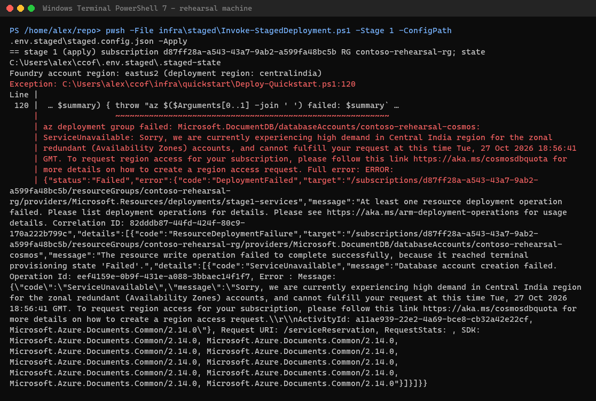
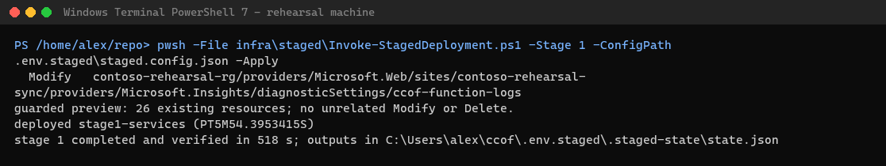
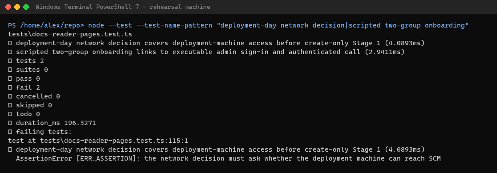
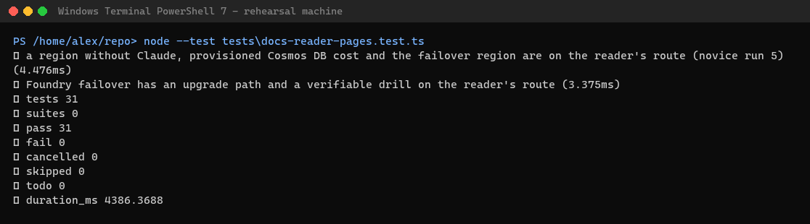
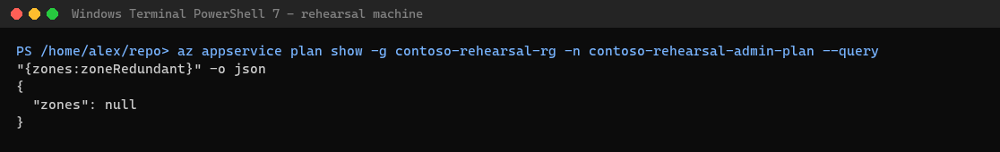
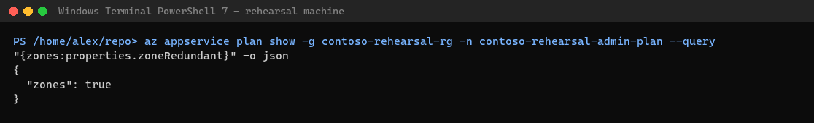
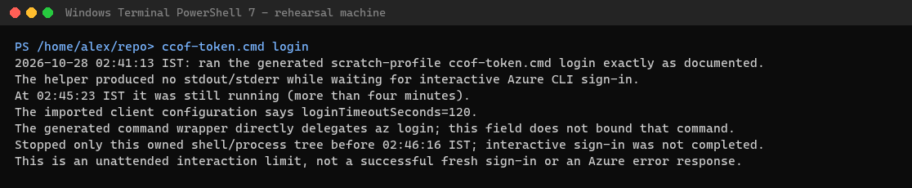
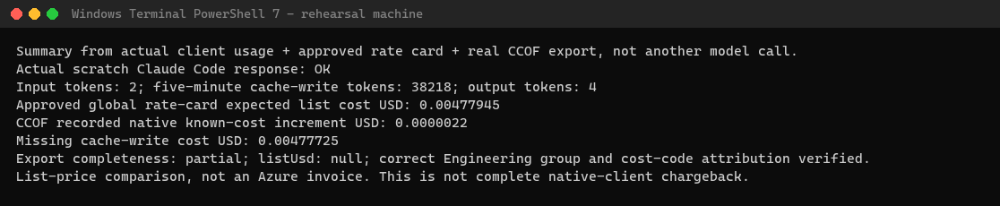
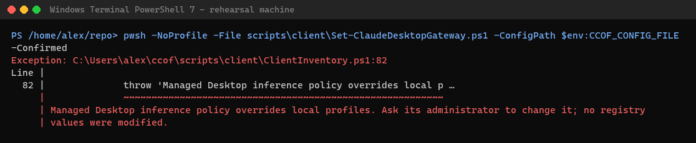

The login capture is a timestamped observation of an otherwise silent process, not an invented Azure error.
The native-cost capture is a derived comparison of actual client usage, the approved global rate card and
the real export, not another model call or an Azure invoice. Raw source records are retained privately.
The HA source was first consulted after the unexpected null read-back, not to choose deployment settings.

## Stage timings

| Step | Measured successful apply | Guide allowance |
| --- | --- | --- |
| Stage 0 | 108 seconds; recovery preflight 137 seconds | 1–3 minutes |
| Initial Stage 1 failure | 241 seconds, not a successful apply | Failures extra |
| Refusal through approved verified recovery | 42 minutes 57 seconds, including waiting for the new approval | Approvals/failures outside the window |
| Stage 1 recovery | 518 seconds | 5–10 minutes |
| Stage 2 | 258 seconds | About 4 minutes |
| Stage 3 | 881 seconds | 7–15 minutes |
| Stage 4 | 71 seconds | About 1 minute |
| Stage 5 | 130 seconds | About 2 minutes |
| Stage 6 | 886 seconds | 12–15 minutes |
| Stage 7 | 1,426 seconds | 20–25 minutes |
| Stage 8 | 324 seconds initially; 132 seconds for console-only second-group proof | About 5 minutes |

The complete two-group snapshot wrapper took about 170 seconds; its actual Function run took 609 ms.
Do not confuse that server-only duration with the deployer's total waiting time.
From first brief read to **two groups with completely priced API requests**: **2 h 12 min 21 s**.
A real Claude Code reply followed; complete native stream pricing did not.

## Success run

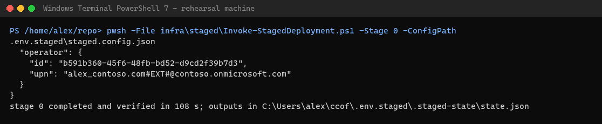
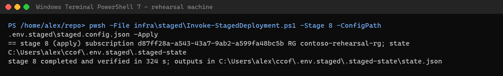
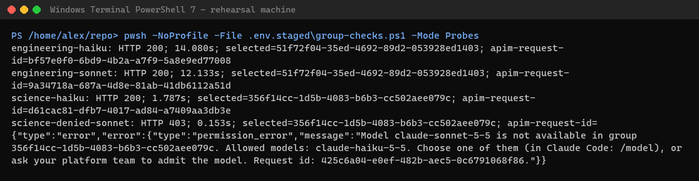
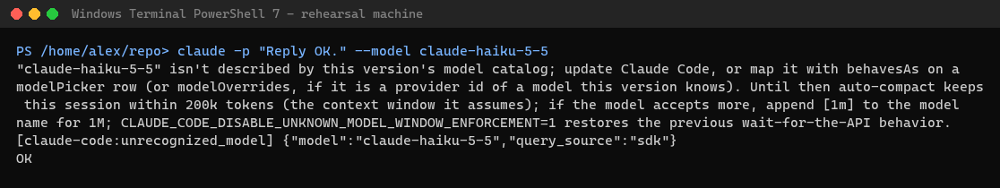
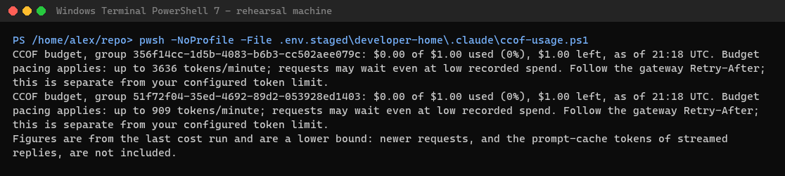

- Second group onboarding returned **201**; both groups active. A fresh complete-catalog snapshot
  succeeded with two memberships of **one person**, zero write failures.
- Engineering Haiku/Sonnet and Science Haiku returned **200**. Science Sonnet returned **403** naming Haiku.
  Exact request traces identify selected group, actual charged group, `group` scope and distinct cost codes.
- After reconciliation, higher-spend Science won the no-selector request despite lower priority.
  Stage 8 then passed against this console-only group with the stricter charged-group proof.
- The [five deployment-day console captures](../2026-10-28-deployment-day/README.md) were replaced from this
  actual group-only lab, preserving their established pseudonyms. Both budget snapshot links were clicked.
  Captures wait for all loading indicators; zero counts seen during an initial loading frame were not
  misreported as a product defect. The final images follow an admin-only refresh from merged release-22
  source; no seed, membership, gateway policy, resolver or sync package was changed by that refresh.
- Windows setup returned configured/azure-cli, usage skill true and status line set. Real Claude Code
  returned **OK** in about ten seconds. The model-free usage wrapper displayed both budgets.

## Authentication and open limits

The fresh interactive login could not finish unattended. For the actual client probe, only the **same owner's**
approved sign-in cache was copied locally into the isolated helper profile; no other person's cache was used.
The copy is removed at cleanup. This is explicitly **not new interactive login proof**.
No token or authorization header is in these captures.

Browser captures use the real deployed UI and real authorized APIs. Only that isolated browser's fetched sign-in
configuration is changed to demo mode, with the approved own CLI token attached to API reads. No API data is mocked.
The demo-editor label reflects this substitution, not an interactive MSAL sign-in.

The missing native stream cache categories are an existing known limit ([cost model](../../COST-MODEL.md#where-the-slop-comes-from),
[ADR-0038](../../adr/0038-budget-admission-acceptance.md)), High for customer expectations, not a new defect.
Live figures read below the bill until daily reconciliation/calibration; the release-23 day guide now says so.
No failover drill, three-person acceptance, native interactive `/usage`,
VS Code extension, Desktop reply or Intune/Office/Cowork pilot was proven. Desktop's managed policy was respected.
The resource group remains running and billable. Production needs its own Cosmos approval, enterprise quota,
Graph consent/processing capacity and load evidence; small-pilot success does not establish 25,000-user capacity.

## Rating from a first-time reader

| Area | Before fixes | After | Evidence limit |
| --- | --- | --- | --- |
| Deployment | 7/10: clear stages/capacity warning | 8/10: real recovery and all stages completed | External approvals, previews and people are outside measured applies |
| Configuration | 7/10: complete example but SCM choice easy to miss | 8/10: create-only decision and actual HA read-back clarified | Fleet capacity is not inferred from this small lab |
| User onboarding | 6/10: setup works but timeout promise misleading | 7/10: exact login boundary and safe policy refusal explained | Existing-cache substitution; complete native pricing and interactive login remain unproven |
