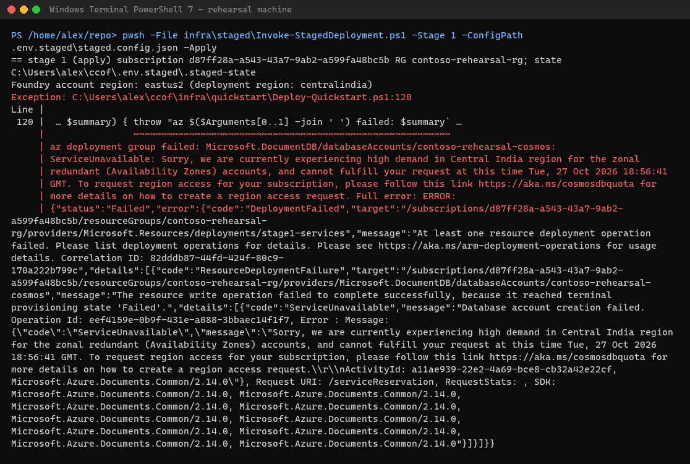
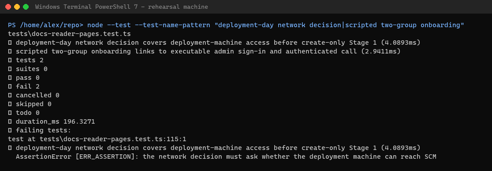
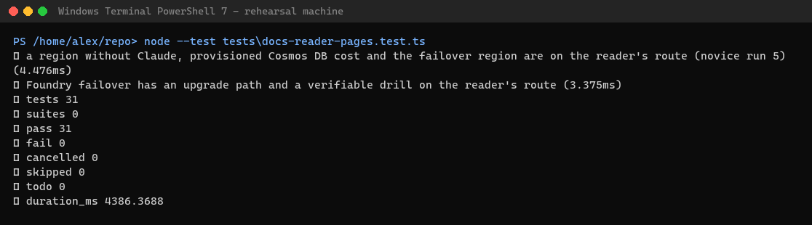
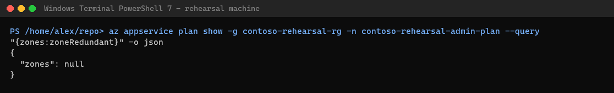
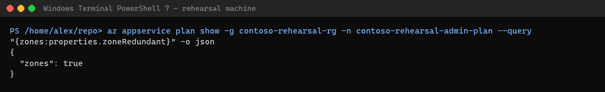
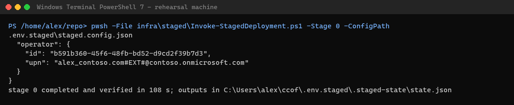

# Deployment-day novice rehearsal, 2026-10-28

This is a new, isolated live deployment, not a replay of an earlier successful lab.
Names, paths and GUIDs in these captures are pseudonyms. The real logs remain private.
**The run stopped at the documented Cosmos capacity/owner-approval boundary. It is not rollout acceptance.**

## Route

README → deployment-day → deployment-day-config → linked prerequisites, HA, Foundry failover and stage
instructions → group onboarding and developer pages. No deployment source was needed to identify the failure.
The deployment uses Central India, primary Foundry East US 2, standby Central US and lab network-create mode.
Both Foundry accounts deploy Haiku and Sonnet version 2 at capacity 2 each after checking free quota.
The approved lab uses two APIM units rather than the guide's initial four-unit rollout example.
Public Functions/SCM access was selected from the linked deployment guide because the workstation is not
connected to the new VNet. Other backends stay private.

Only the existing gateway/resolver IDs were read from an approved older config; the new configuration was
filled from the decision page's complete example, not copied from that config. Shared applications have
not been changed. A new admin registration was planned, not yet created.

## What failed, and what changed

| # | Step | Observation | Result | Image |
| --- | --- | --- | --- | --- |
| 1 | Stage 1 | `ServiceUnavailable`: high demand for Central India zonal Cosmos accounts | The guide correctly predicts it. Saved creation-failure operations, null endpoint, failed database-list output and absent Stage 1/2 completion. No deletion, downgrade or retry without explicit owner approval. | [fail-01-cosmos-zonal-capacity.png](fail-01-cosmos-zonal-capacity.png) |
| 2 | Configuration/admin API route | Workstation-to-SCM access was not a decision on the configuration page; linked admin Sign-in lacked executable token/GET instructions | Two reader contracts failed first; the precise guide changes passed all 31 reader checks and both mutations were caught at that checkpoint. | [fail-02-reader-decisions.png](fail-02-reader-decisions.png), [fix-02-reader-decisions.png](fix-02-reader-decisions.png) |
| 3 | HA read-back command | `az appservice plan show` with `zones:zoneRedundant` printed `null` despite a zonal plan | Correct the query to `zones:properties.zoneRedundant`. Live retry prints `true`; the new reader contract fails first and its mutation is caught. All 32 reader tests pass. | [fail-03-functions-ha-readback.png](fail-03-functions-ha-readback.png), [fix-03-functions-ha-readback.png](fix-03-functions-ha-readback.png) |

The Cosmos capture is an excerpt of the initial failed apply log; the complete raw provider error is kept
privately. The reader RED capture shows the actual two-test run summary and first assertion, not a model
call or another live deployment failure. Capture commands identify the real execution platform.
After the unexpected null read-back, the raw CLI/ARM JSON and staged zone-verification source were consulted
to diagnose it. That was the first deployment-source lookup and is not counted as first-reader knowledge.

## Stage timings

| Step | Measured wall time | Guide allowance |
| --- | --- | --- |
| Read/setup/configure, from first brief read | About 3 minutes to first preflight | Advance preparation, outside deployment window |
| Stage 0 | 110 seconds wall; script reports 108 seconds | 1–3 minutes |
| Stage 1 preview | 5 seconds | Not separately estimated |
| Initial Stage 1 apply | 241 seconds, failed | 5–10 minutes for a successful apply; failures extra |
| Failed-empty-account read-only checks | 12 seconds | Not separately estimated |
| Stages 2–8, groups and clients | Not reached | Not inferred from earlier labs |

## Success run

Stage 0 passed and verified the requested APIM/Functions/storage/Cosmos regional zone support and both
Foundry offers/quota. This did not reserve Cosmos service capacity:

The failed Stage 1 did create other billable resources, including both Foundry accounts. It never wrote a
Stage 1 completion. No model request has been sent and no developer/client acceptance is claimed.
The group-only console source is merged in this worktree but has not been published by Stage 7.

## Open items

- Explicit approval or approved capacity is still needed for Cosmos recovery; regional support is not capacity.
- No two-group onboarding/accounting, three-person checks or developer interactive sign-in yet.
- Installed-client detection found Claude Code and Desktop, not a VS Code extension. No Intune tenant is available.
- The resource group is intentionally left running; stopping at a failed Cosmos create does not stop other costs.
- The new client guide exposes a cross-platform documentation-scanner failure in the full root suite:
  explicitly Windows-only client snippets are scanned as deployer commands. This is separate from the
  live capacity block; do not treat a failing full suite as a passing release.

## Rating from a first-time reader

| Area | Before | After precise reader fixes |
| --- | --- | --- |
| Deployment | 7/10: clear stages and honest capacity warning, but live completion remains blocked | 7/10: approval boundary remains deliberately closed |
| Configuration | 7/10: complete validated example, but workstation access was easy to miss | 8/10: private/public lab decision is at the create-only decision point |
| User onboarding | Not rated: not exercised | Not rated: prose review cannot substitute for client sign-in |
