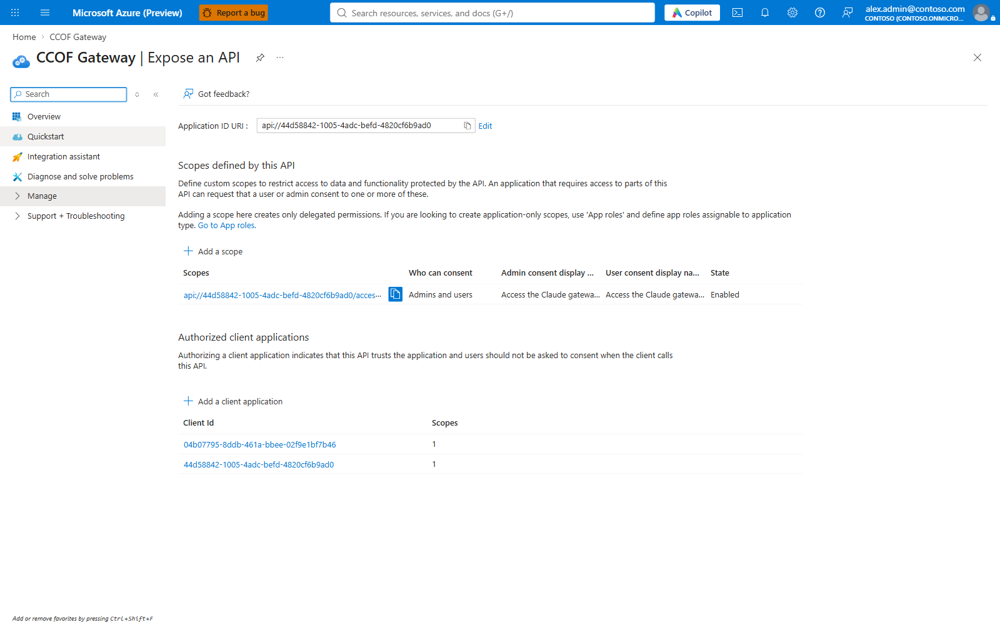
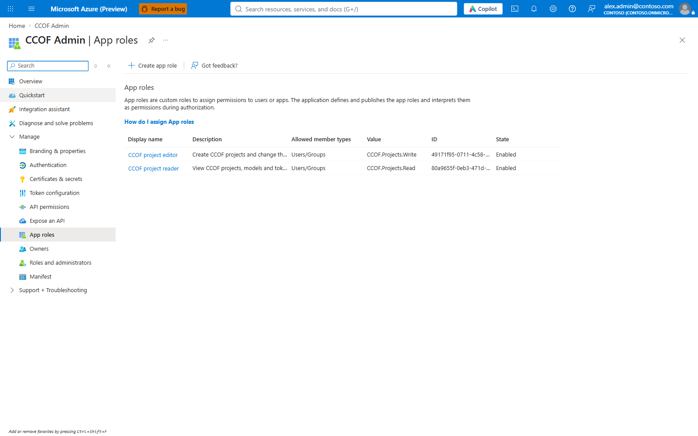
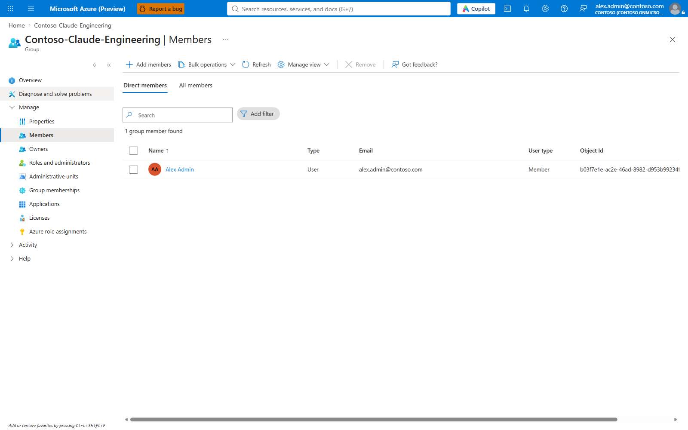

# 2. Prerequisites

Tick every line before Stage 0. Each item names who provides it. Details and least-privilege roles:
[staged guide, section 2](../STAGED-DEPLOYMENT-GUIDE.md#2-prerequisites).

## Single-subscription lab path

The 2026-10-24 lab used one Azure subscription and `network.mode: create`; Stage 6 created its own VNet and
integrations. Stages 0–8 took 62 minutes in that run. Times vary. API Management, Cosmos DB and Functions incur
charges while deployed; model calls add usage charges.

**Rough lab cost.** The largest fixed charge is API Management Standard v2: USD 0.96 per hour for one unit, about
USD 23 per day. Each private endpoint is USD 0.01 per hour; the lab has six, about USD 1.44 per day. The lab is
therefore about USD 25 per day before usage-based charges (Functions Flex Consumption, serverless Cosmos DB, storage,
Log Analytics and model tokens). Prices are USD list prices from the Azure Retail Prices API, retrieved 2026-10-24:
[API Management Standard v2, East US 2](https://prices.azure.com/api/retail/prices?$filter=serviceName%20eq%20%27API%20Management%27%20and%20armRegionName%20eq%20%27eastus2%27%20and%20skuName%20eq%20%27Standard%20v2%27)
(meter `Standard v2 Unit`) and
[Private Link](https://prices.azure.com/api/retail/prices?$filter=productName%20eq%20%27Virtual%20Network%20Private%20Link%27%20and%20armRegionName%20eq%20%27Global%27)
(meter `Standard Private Endpoint`, a Global price). Agreements and regions differ. Actual spend is in the Portal: the resource group → **Cost analysis**. Cost data for EA and MCA
subscriptions typically appears within 8–24 hours, and pay-as-you-go can take up to 72 hours
([Understand Cost Management data](https://learn.microsoft.com/azure/cost-management-billing/costs/understand-cost-mgt-data)).
Deleting the resource group stops these charges.

The lab path still needs a subscription with quota for the selected Claude models, a new empty resource group,
platform Contributor and Role Based Access Control Administrator access, and an Entra administrator or owners of
the three existing app registrations. Existing Entra apps and groups can be reused when approved. Set
`network.mode` to `create` only for a lab; production deployments use a customer-built network and `verify` mode.
The [demo evidence](../evidence/2026-10-24-demo/README.md) records which directory objects were reused.

## People and approvals

- [ ] **Platform engineer** with Contributor on a new, empty resource group (and permission to create it).
- [ ] **Access administrator** with Role Based Access Control Administrator on that resource group (Stage 3).
- [ ] **Entra administrator** for the three app registrations (Application Administrator, or owner of existing apps).
- [ ] **Privileged Role Administrator**, only if Microsoft Graph application permissions are approved (automatic
      group sync, group search, people's names).
- [ ] **Network team**, unless a lab creates its own network (`network.mode: create`).
- [ ] **Cost approval** for API Management Standard v2, Function Apps, Cosmos DB, Log Analytics and model usage.

## Tools (Azure Cloud Shell has them all)

- [ ] PowerShell 7.2 or later, Azure CLI with Bicep, Node.js 22 and npm, Git.

## Microsoft Foundry models

- [ ] Claude deployments that exist, or quota and purchase rights for Stage 1 to create them. Check the quota (the
      table output of this command omits the quota names, so the names are selected from the JSON):

```powershell
az cognitiveservices usage list -l eastus2 -o json | ConvertFrom-Json |
  Where-Object { $_.name.value -like '*claude*.Azure' } |
  Select-Object @{ n = 'quota'; e = { $_.name.value } }, currentValue, limit
```

Each line is `AIServices.<sku>.<model>.Azure`; free capacity is `limit` minus `currentValue`. It maps to one entry
in `stage1.foundry.deployments` and one in `backends[].deploymentInferenceGeo`:

| Quota line | `model` | `sku` | `capacity` | `deploymentInferenceGeo` |
| --- | --- | --- | --- | --- |
| `AIServices.GlobalStandard.claude-sonnet-5-5.Azure`, 0 of 80 used | `claude-sonnet-5-5` | `GlobalStandard` | up to 80 | `global` |
| `AIServices.DataZoneStandard.claude-haiku-5-5.Azure`, 0 of 27 used | `claude-haiku-5-5` | `DataZoneStandard` | up to 27 | `us` |

`us` (DataZone) usage is priced at 1.1 times `global` in [config/rate-card.json](../../config/rate-card.json).

The `version` comes from the model list; Stage 0 refuses a model, version or `sku` the region does not offer:

```powershell
az cognitiveservices model list -l eastus2 -o json | ConvertFrom-Json |
  Where-Object { $_.model.format -eq 'Anthropic' } |
  Select-Object @{ n = 'model'; e = { $_.model.name } }, @{ n = 'version'; e = { $_.model.version } },
    @{ n = 'skus'; e = { ($_.model.skus.name | Sort-Object -Unique) -join ', ' } } | Sort-Object model, version -Unique
```

Model names in `groups[].familyPolicy.families`, `client.models` and `acceptance` use the same deployment names.

## Network (customer-built mode)

- [ ] A virtual network with three subnets: Functions (delegated to `Microsoft.App/environments`), private
      endpoints, and API Management (delegated to `Microsoft.Web/serverFarms`, with an NSG).
- [ ] Private DNS zones for Cosmos DB, blob storage and Foundry, linked to the VNet.
- [ ] Outbound HTTPS from the Function Apps to Entra ID, Microsoft Graph and Azure Monitor.

Full list with NSG rules: [guide 2.2](../STAGED-DEPLOYMENT-GUIDE.md#22-network).

## Entra applications

Stage 4 creates them, or merges its settings into existing ones (`entra.existing`). What each must show when done:

| Application | Must show |
| --- | --- |
| **CCOF Gateway** | **Expose an API**: `api://<appId>` with the delegated scope `access_as_user` |
| **CCOF Resolver API** | `api://<appId>`, no secrets, no redirect URIs |
| **CCOF Admin** | **App roles** `CCOF.Projects.Read` and `CCOF.Projects.Write`; "Assignment required" on |





## Entra groups

- [ ] One existing **security group** per team to onboard, with the developers as **direct members** (nested
      groups and devices are not counted).



## Decide before you start

| Decision | Options | Where it is set |
| --- | --- | --- |
| How membership is read | **Automatic** (Graph permission granted, sync timer on) or **snapshot** (an operator applies changes) | `sync`, `syncTimerEnabled`; [guide 6.1](../STAGED-DEPLOYMENT-GUIDE.md#61-graph-grants-group-search-names-and-sync) |
| Dollar budgets enforced | `budget-state` (enforced) or `token-limits-only` | `resolver.budgetEnforcement` |
| Budget guard | Example: warn at 80%, rate allowance 5% per projection window; not a strict cap | `reconciler.budgetGuard`; [budgets](../operate/budgets-and-guard.md) |
| Cosmos DB redundancy | One region, or two regions with failover | `stage1.cosmosLocations`; [guide 2.6](../STAGED-DEPLOYMENT-GUIDE.md#26-cosmos-db-redundancy) |
| Developer sign-in | `msal` (default: the CCOF helper, Node.js on each machine) or `azure-cli` (interactive `az login` through a helper; the Azure CLI on each machine). Before Stage 4 | `client.signInMethod`, and `entra.allowAzureCliClient: true` for `azure-cli`; [guide 6.6](../STAGED-DEPLOYMENT-GUIDE.md#66-azure-cli-developer-sign-in) |
| Long-term audit archive of the gateway log | On (template) or off. A storage account and a second diagnostic setting; about USD 0.25 per GB of LLM log exported, once, plus about USD 0.02 per GB per month kept (Hot LRS) | `audit.archive`; [audit archive](../operate/audit-archive.md) |
| Chargeback history beyond the Log Analytics retention | Off (template) or on. On needs `reconciler.timerEnabled: true`, which the template also leaves off; set both to `true` together. A Cosmos DB container; for 1,000 active people, under USD 2 a month in writes on serverless plus USD 0.25 per GB per month stored | `audit.chargebackHistory`; [chargeback history](../operate/chargeback-history.md) |

Next: [deploy](03-deploy.md).
