# 3. Deploy: Stages 0–8

Nine stages, run in order from Azure Cloud Shell (PowerShell). Every stage first **previews** and changes nothing;
the same command with `-Apply` makes the change and then reads it back. A stage that fails its read-back stops
with `verify_failed: <reason>` and records nothing, so it can be run again.

The captures on this page come from one demo deployment on 2026-10-24
([evidence](../evidence/2026-10-24-demo/README.md)). Names and IDs in them are hypothetical replacements of the
real ones, in the same format. Every setting and the Portal way of each stage: [staged guide](../STAGED-DEPLOYMENT-GUIDE.md#4-stages-0-to-8).

## Before Stage 0: get the code and write the configuration

```powershell
cd $HOME; git clone https://github.com/naveenneog/CCOF.git ccof; cd ccof
npm ci --ignore-scripts --include=dev
az account set --subscription '<subscription-id>'
New-Item -ItemType Directory -Force $HOME/ccof-private | Out-Null
Copy-Item infra/staged/staged.config.example.json $HOME/ccof-private/staged.config.json
code $HOME/ccof-private/staged.config.json        # replace every REPLACE- value
$cfg = "$HOME/ccof-private/staged.config.json"
$run = "infra/staged/Invoke-StagedDeployment.ps1"
```

The configuration keys are listed in [guide 3.3](../STAGED-DEPLOYMENT-GUIDE.md#33-configuration-file). For each
stage: run it without `-Apply`, read the preview, have the stage's owner approve, then run it with `-Apply`.

---

## Stage 0 — Preflight (read-only)

**Who:** platform engineer · **Time:** about 1 minute · **Changes:** nothing in Azure

```powershell
pwsh -File $run -Stage 0 -ConfigPath $cfg
```

**Expected:** providers `Registered`, the region, the planned Foundry deployments, the operator, and the last line
`stage 0 completed and verified in … s`.

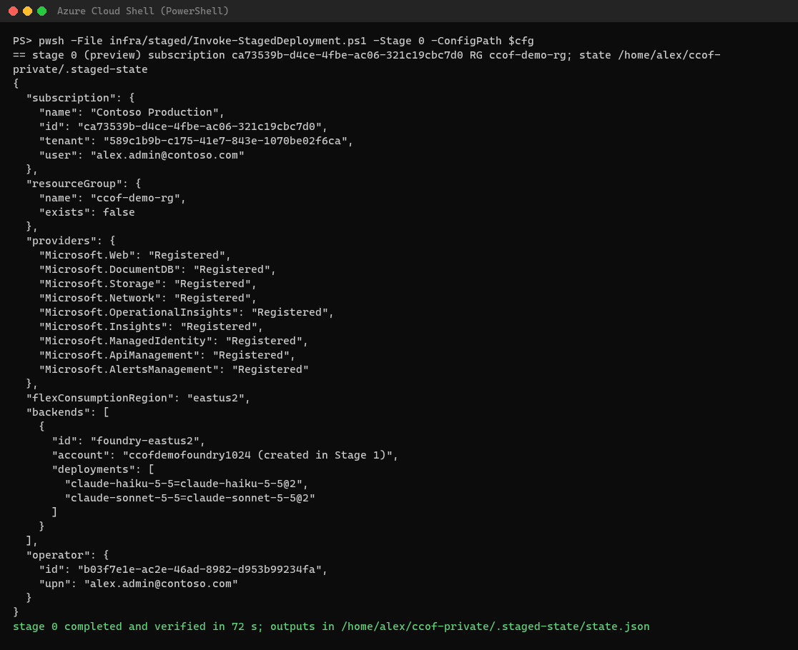

## Stage 1 — Resources

**Who:** platform engineer · **Time:** about 5 minutes · **Creates:** the resource group, Log Analytics, Application
Insights, Cosmos DB account, storage, managed identities, four Function Apps, API Management, the Foundry account and
its Claude deployments. No settings, data or role assignments yet.

```powershell
pwsh -File $run -Stage 1 -ConfigPath $cfg -Apply
```

**Expected:** `deployed stage1-services (…)` and `stage 1 completed and verified in … s`.


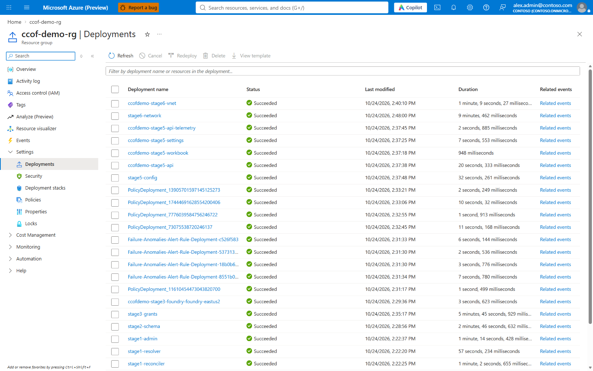
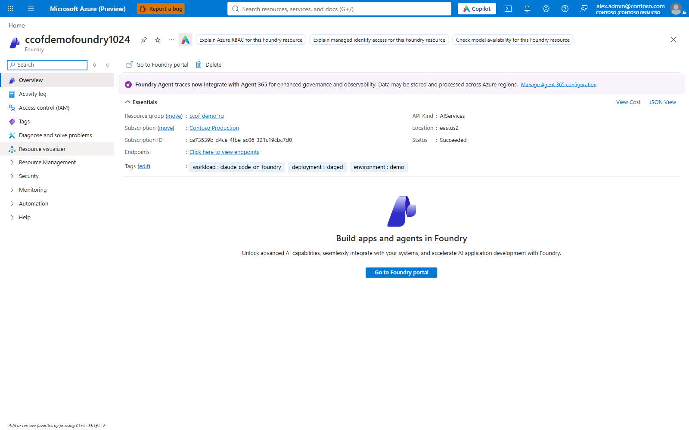

## Stage 2 — Cosmos DB schema

**Who:** platform engineer · **Time:** about 3 minutes · **Creates:** the `ccof` database and its containers.

```powershell
pwsh -File $run -Stage 2 -ConfigPath $cfg -Apply
```

**Expected:** `deployed stage2-schema (…)` and `stage 2 completed and verified in … s`.


## Stage 3 — Runtime role assignments

**Who:** access administrator · **Time:** about 6 minutes · **Creates:** each managed identity's Azure and Cosmos DB
roles, and Cognitive Services User for API Management on the Foundry account. Not Microsoft Graph permissions.

```powershell
pwsh -File $run -Stage 3 -ConfigPath $cfg -Apply
```

**Expected:** `deployed stage3-grants (…)` and `stage 3 completed and verified in … s`.

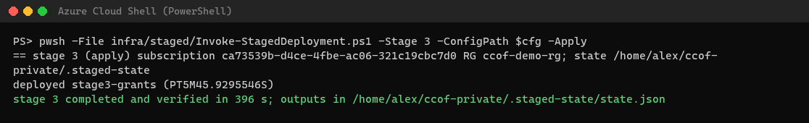
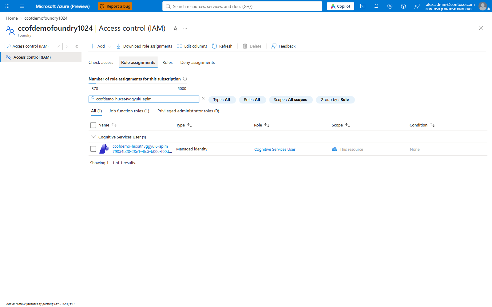

## Stage 4 — Entra applications and groups

**Who:** Entra administrator · **Time:** about 1 minute · **Creates or updates:** the three app registrations
([prerequisites](02-prerequisites.md#entra-applications)) and, when the configuration names them, the groups.

```powershell
pwsh -File $run -Stage 4 -ConfigPath $cfg -Apply
```

**Expected:** one line per application (`reuse existing …` or `created …`) and `stage 4 completed and verified in … s`.

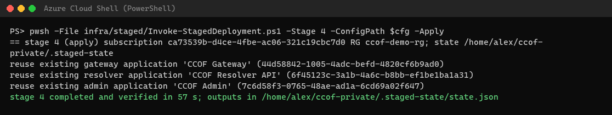

## Stage 5 — Configuration

**Who:** platform engineer · **Time:** about 2 minutes · **Writes:** every app's settings, the resolver's
authentication, the gateway API, its policy (as policy fragments), the `/usage` operation and the chargeback
workbook.

```powershell
pwsh -File $run -Stage 5 -ConfigPath $cfg -Apply
```

**Expected:** a JSON line with the policy digests, `deployed stage5-config (…)` and `stage 5 completed and verified in … s`.

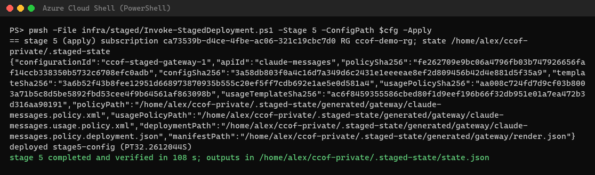
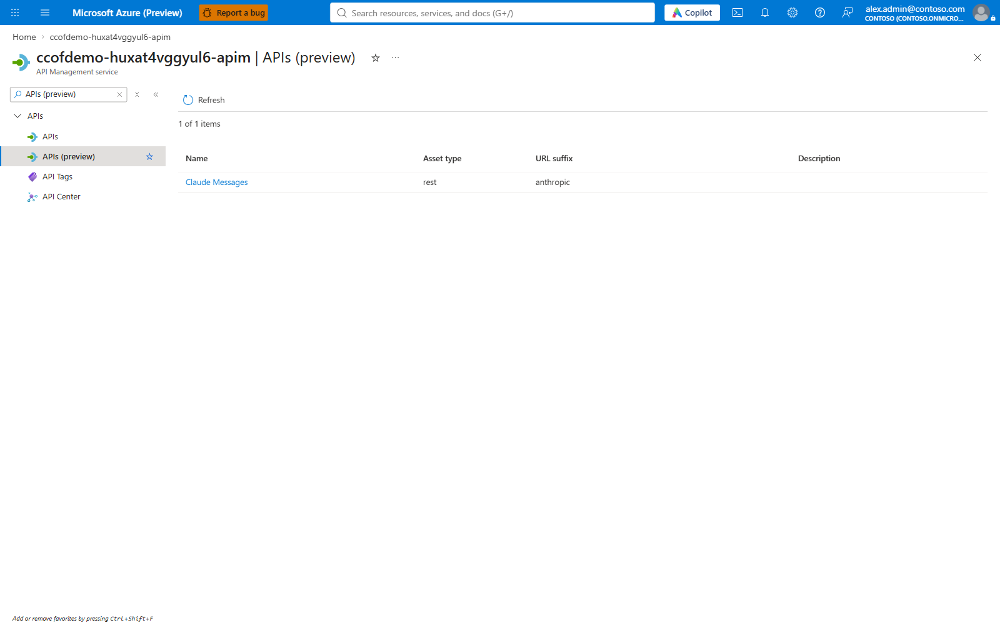
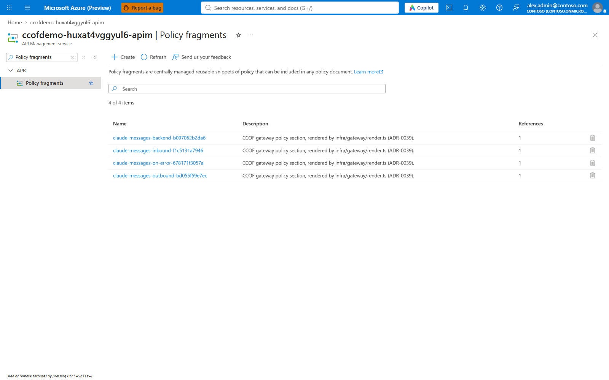
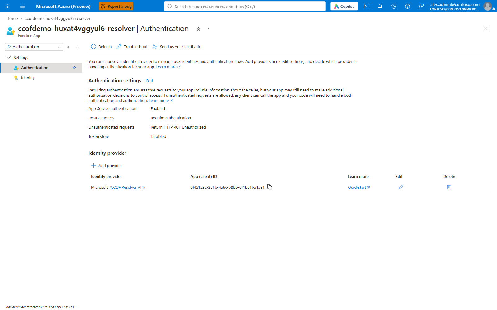

## Stage 6 — Network

**Who:** network team · **Time:** about 15 minutes (API Management VNet integration) · **Creates or checks:**
private endpoints, DNS zone links, Function App and API Management VNet integration. In `verify` mode it only checks.

```powershell
pwsh -File $run -Stage 6 -ConfigPath $cfg -Apply
```

**Expected:** `… integrated with snet-functions` per app, the API Management wait, and `stage 6 completed and verified in … s`.

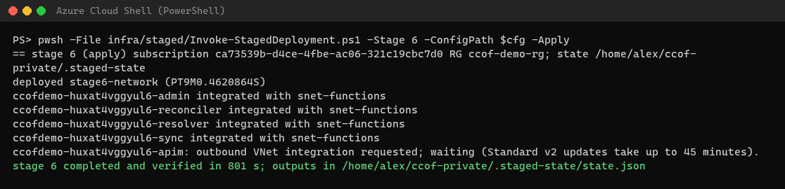
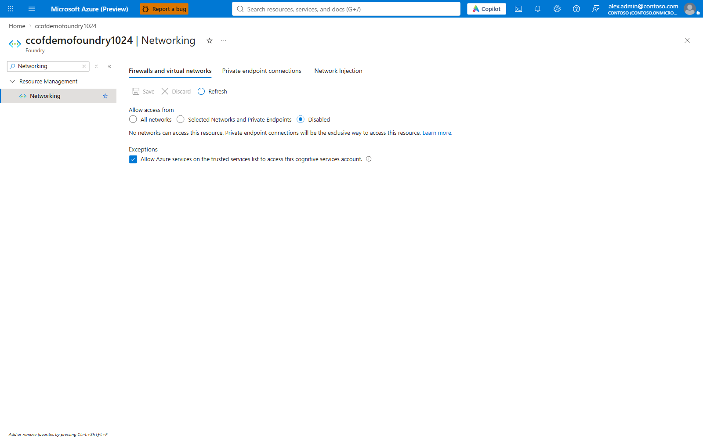
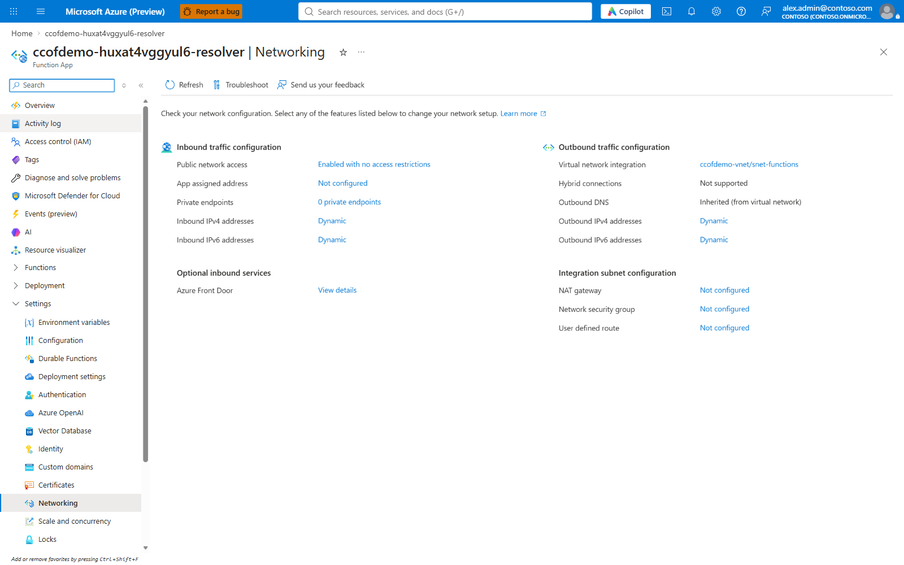

## Stage 7 — Code and initial data

**Who:** platform engineer · **Time:** about 25 minutes · **Publishes** the four Function App packages, **seeds**
the backend and the groups in the configuration, **applies** a membership snapshot, and writes the developer
client file. One Stage 7 at a time per checkout.

```powershell
pwsh -File $run -Stage 7 -ConfigPath $cfg -Apply
```

**Expected:** `… : created` per seeded document, a `ccof.sync.run.v1` line with `"outcome":"succeeded"` and
`membersAdmitted`, the `Set-ClaudeCodeGateway.ps1` command for developers, and `stage 7 completed and verified in … s`.
A first run right after Stage 6 can stop with a storage `403`; rerun after about five minutes
([troubleshooting](../operate/troubleshooting.md)).

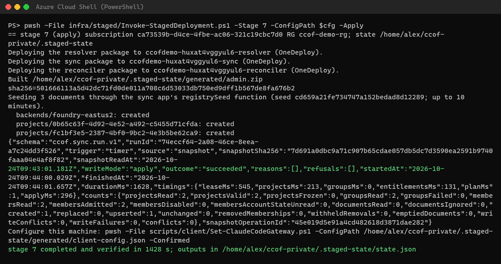
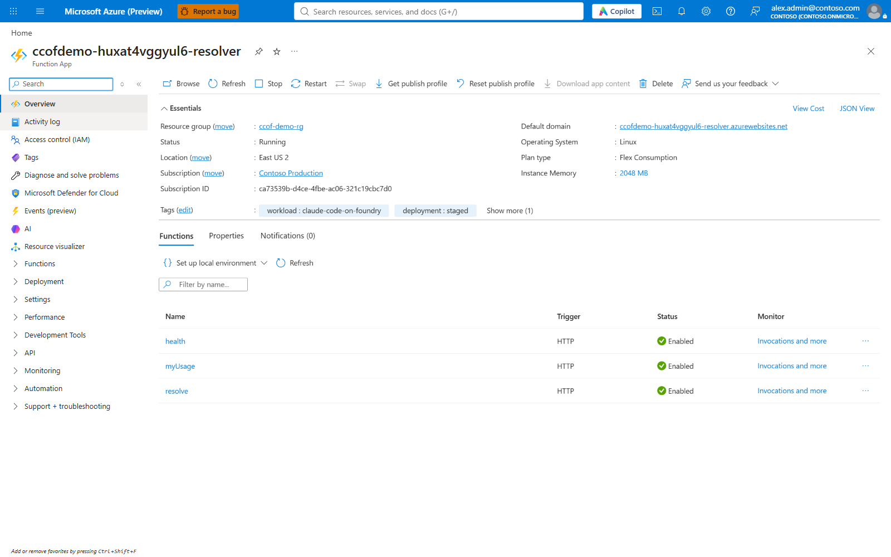

## Stage 8 — Acceptance

**Who:** platform engineer, signed in as a member of an onboarded group · **Time:** about 3 minutes ·
**Calls the gateway:** without a token (`401`), with allowed models (`200`), with a model no group admits (`403`);
checks the admin console and that every request reached the usage ledger, charged to the expected group.

```powershell
pwsh -File $run -Stage 8 -ConfigPath $cfg -Apply
Get-Content "$HOME/ccof-private/.staged-state/evidence/stage8.verify.json"
```

**Expected:** `stage 8 completed and verified in … s`; the evidence shows `anonymous.status 401`, each allowed
model `200` with the reply `STAGED OK`, the denied model `403`, and the telemetry rows.

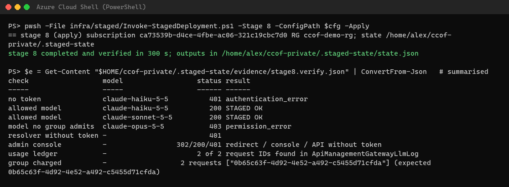

Next: [onboard an Entra group](04-onboard-a-group.md).
