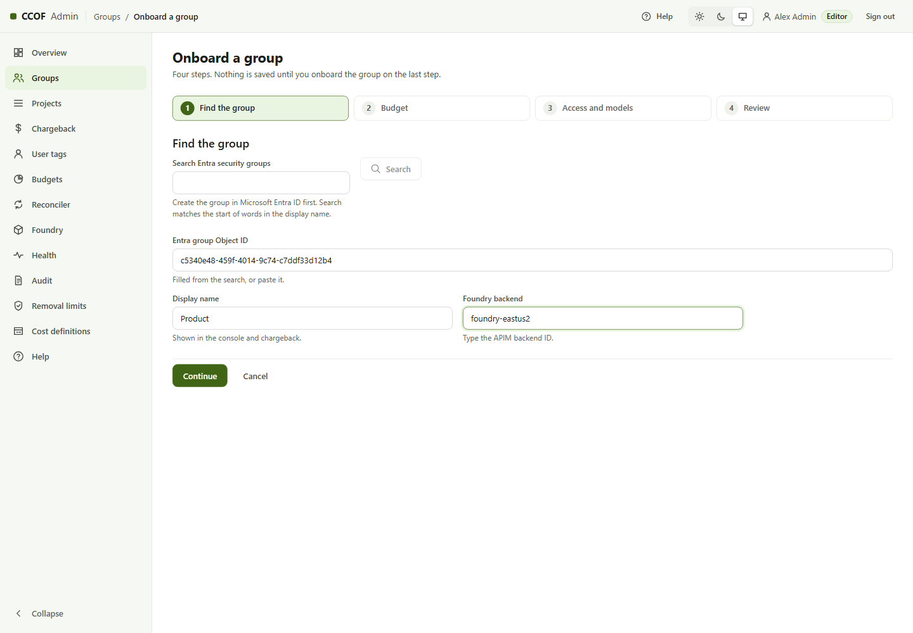
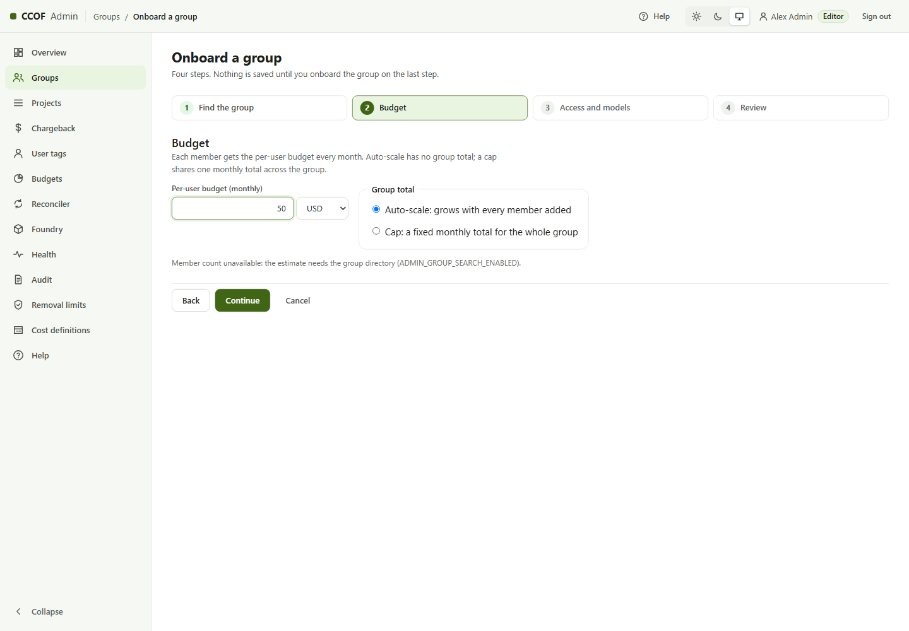
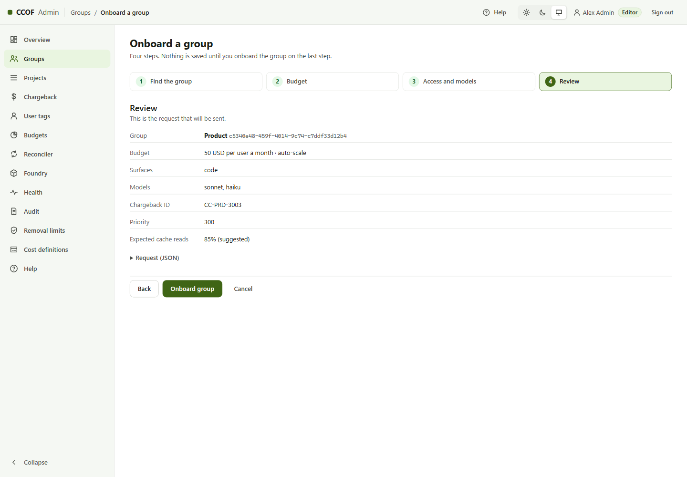
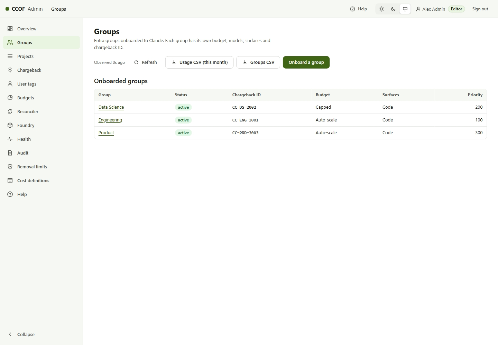
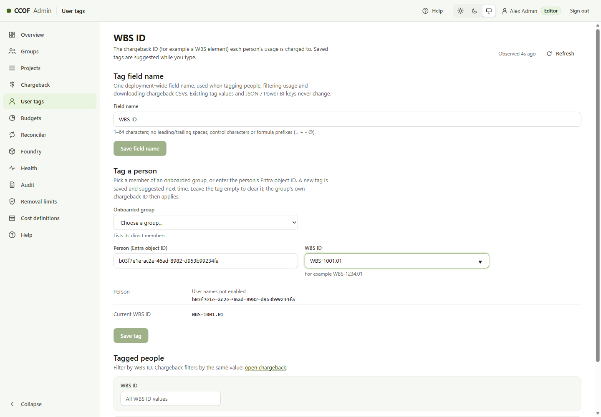

# 4. Onboard an existing Entra group

**Who:** an admin console editor (app role `CCOF.Projects.Write` on **CCOF Admin**) · **Time:** about 5 minutes per
group · **Changes in Entra:** none. CCOF reads the group; people are still added and removed in Entra.

Each onboarded group is a separate entity with its own budget, models, limits and chargeback ID. A person can be in
several onboarded groups; each gives a separate budget ([users and groups](../operate/users-and-groups.md)).

The console is at `https://<admin-app>.azurewebsites.net/api/console-v3`. Sign in with your work account.

The screenshots predate the group-only console. Their **Projects** sidebar entry
has been removed. Onboard and manage every team through **Groups**. Old project
bookmarks show an explanation and a Groups link, not a project editor.

## Step 1 — Find the group

**Groups → Onboard a group.** Search by display name (needs the admin Graph permission,
[guide 6.1](../STAGED-DEPLOYMENT-GUIDE.md#61-graph-grants-group-search-names-and-sync)) or paste the group's
**Object ID** from Entra ID → Groups. Enter the display name used in reports and choose the Foundry backend from
the list of the deployment's backends (Stage 5 writes it). The console then lists the models deployed on that
backend; the admin API refuses any other backend or model
([ADMIN-API](../ADMIN-API.md#onboarded-groups-adr-0034)).

## Step 2 — Budget

Monthly budget per user, in USD or CCU. **Auto-scale**: every member gets it and the group has no total.
**Cap**: members also share one monthly total. The page shows the total for the current members.

## Step 3 — Access and models

Allowed surfaces (for example Claude Code), the group's **chargeback ID** (people without a user tag are charged to
it), **priority** (when a person is in several groups and names none: the group with the higher spend this month,
then the lower number), and the **models**: the families and exact model IDs, with optional token limits per person
and per group. Restricted families (Fable, Mythos) only with approval.

The next review step shows the requested chargeback ID and priority by name before submission.

## Step 4 — Review and onboard

The page shows the exact request. **Onboard group** saves it; the change is recorded in the audit log.

## Expected result

The group is listed **active**. Its members get access after a successful sync or snapshot. With the automatic
timer, this is the next successful scheduled run. In snapshot mode the operator includes the new group's ID in
[a fresh snapshot of all registered groups](../operate/users-and-groups.md#snapshot-mode-after-console-changes);
rerunning Stage 7 alone does not include groups added only through the console.

## Optional — cost codes per person (user tags)

**User tags → Tag field name:** name the field once for the deployment, for example **WBS ID**. **Tag a person:**
pick a member or paste their Object ID, type the value (saved values are suggested as you type), **Save tag**. The
person's requests from the next sync on then carry that value instead of the group's chargeback ID
([chargeback and tags](../operate/chargeback-and-tags.md)).

## Change or end it later

- Edit models or limits on the group's page; after successful sync or snapshot, the gateway's cached decision
  can remain for up to two more minutes. Budget figures also need the next reconciler run.
- **Retire** (on the group's page): one way. The next sync removes every member's access; the Entra group is unchanged.

Next: [developer setup](05-developer-setup.md).
