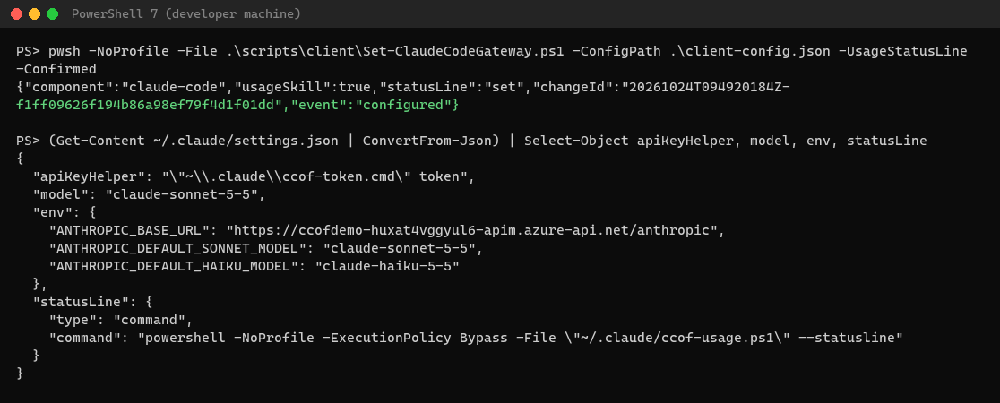
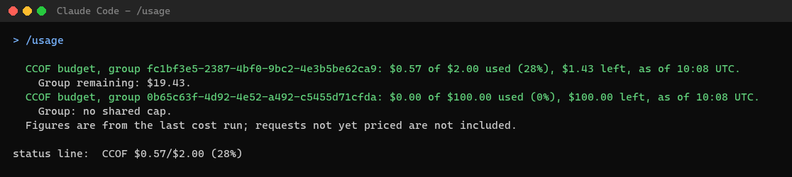
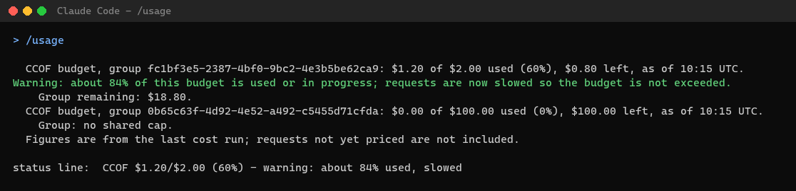

# 5. Developer setup

**Who:** each developer (or the device management team, with the same files) · **Time:** about 5 minutes ·
**Needs:** Claude Code installed, Git, Node.js 22, PowerShell 7, the Azure CLI when the configuration uses the
Azure CLI sign-in, membership of an onboarded group, and the client
configuration file that Stage 7 generated (`client-config.json`), handed over through the approved private channel.

Full details, Claude Desktop and VS Code: [CLIENTS.md](../CLIENTS.md).

**Windows, macOS or Linux.** Every command runs in PowerShell 7 (`pwsh`; on macOS and Linux 7.4 or later). On a Mac
or Linux the setup needs a configuration with `signInMethod: azure-cli` and the Azure CLI (macOS:
`brew install azure-cli`, [Learn](https://learn.microsoft.com/cli/azure/install-azure-cli-macos)); with another
method it stops with `unsupported_sign_in_method` and changes nothing. Claude Desktop setup is Windows-only.
Platform details: [CLIENTS.md, macOS and Linux](../CLIENTS.md#macos-and-linux).

## 0. Get the code

```powershell
cd $HOME; git clone https://github.com/naveenneog/CCOF.git ccof; cd ccof
```

Every command on this page runs from the `ccof` folder. A machine that already has the folder runs `git pull` in
it instead.

## 1. Install the helper and configure Claude Code

**Windows:**

```powershell
npm ci --prefix .\client --no-audit --no-fund
$env:CCOF_CONFIG_FILE = (Resolve-Path '<client-config.json>').Path
pwsh -NoProfile -File .\scripts\client\Set-ClaudeCodeGateway.ps1 -ConfigPath $env:CCOF_CONFIG_FILE -Confirmed
```

**macOS or Linux**, in `pwsh`: put the configuration in the configuration folder, then run setup without
`-ConfigPath` (it uses `$XDG_CONFIG_HOME/ClaudeGateway/config.json` if `XDG_CONFIG_HOME` is set):

```powershell
npm ci --prefix ./client --no-audit --no-fund
New-Item -ItemType Directory -Force ~/.config/ClaudeGateway | Out-Null
Copy-Item '<client-config.json>' ~/.config/ClaudeGateway/config.json
pwsh -NoProfile -File ./scripts/client/Set-ClaudeCodeGateway.ps1 -Confirmed
```

Add `-UsageStatusLine` to show the budget continuously in Claude Code's status line.

**Expected:** one JSON line with `"event":"configured"`, `"usageSkill":true`, `"statusLine":"set"` (with
`-UsageStatusLine`), a `changeId`, the configuration's `"signInMethod"` and `"signIn"`, the sign-in command for
step 2, and `"models"`: the deployment each Claude Code model alias runs. The previous settings are backed up under that `changeId`; to undo, see
[CLIENTS.md, Restore](../CLIENTS.md#restore). The settings file
then points Claude Code at the gateway (`ANTHROPIC_BASE_URL`) and the token helper (`apiKeyHelper`). On macOS and
Linux the files are `~/.claude/settings.json` and the helper `~/.claude/ccof-token`, an `sh` script that Claude Code
runs through `/bin/sh`; `"signIn"` is `'/Users/<you>/.claude/ccof-token' login`. Setup creates them readable by you
only, and keeps the helper's Azure CLI sign-in in `~/.config/ClaudeGateway/az`.



## 2. Sign in once

Run the `"signIn"` command from step 1. For Claude Code on Windows it is always:

```powershell
& "$env:USERPROFILE\.claude\ccof-token.cmd" login
```

On macOS and Linux (in `pwsh` or Terminal): `~/.claude/ccof-token login`.

What appears depends on the `"signInMethod"` the administrator chose:

| `signInMethod` | What appears | Needs |
| --- | --- | --- |
| `msal` (default) | Windows uses the signed-in work account (WAM); otherwise a browser window opens | Node.js 22 |
| `azure-cli` | A Microsoft sign-in window from the Azure CLI (on macOS and Linux in the default browser, [Learn](https://learn.microsoft.com/cli/azure/authenticate-azure-cli-interactively)). **Expected:** `Signed in. Claude Code and Claude Desktop now use this sign-in.` (macOS and Linux: `Signed in. Claude Code now uses this sign-in.`) | The Azure CLI (`az version` prints a version) |

No token is ever printed. With `azure-cli` the helper keeps its own Azure CLI profile, so an existing `az login`
for other work is not changed. The same helper also takes `status` (the signed-in account) and `logout`.

Claude Desktop: when its setup prints a `"signIn"` command (`azure-cli`, or an older Desktop with `msal`), run it
once before starting Desktop ([CLIENTS.md, section 3a](../CLIENTS.md#3a-azure-cli-sign-in-signinmethod-azure-cli)).
A newer Desktop with `msal` (`"credentialKind":"external-idp"`) prints none and asks for the sign-in itself
([CLIENTS.md, section 5](../CLIENTS.md#5-configure-claude-desktop)).

## 3. Use Claude Code

Start `claude` as usual. Requests go through the gateway with the models the group admits. A model alias runs the
deployment listed under `"models"` in step 1: when the group admits no Opus, the administrator maps `opus` to another
model, so `/model opus` (or `--model` with an Opus name) runs that model without a notice; `/status` shows the model
in use.

## 4. Check your own budget: `/usage`

In an interactive Claude Code session, type `/usage` and press Enter. The `/` menu shows two `/usage` entries:
the built-in one ("Show session cost, plan usage, and activity stats") and the CCOF one ("Show the CCOF budget
…"); typing `/usage` runs the CCOF one. It prints each of your budgets, as of the last cost run (about a minute old):



`claude -p "/usage"` (a non-interactive run) shows Claude Code's built-in usage instead, not the CCOF budget.

With the example guard, from 80% of projected spend the line adds a warning and requests are slowed to reduce
overshoot. The threshold is configurable; reporting lag means this is not a strict dollar cap.



When recorded spend reaches the budget, new requests through that group are refused until next month or until the
budget is raised. Projected-spend refusal can clear earlier if the estimated in-flight spend falls.

**Once requests are refused, `/usage` cannot show it**: Claude Code sends the skill's figures to the model through
the same gateway, and that request is refused too (`403 … budget … used up`, after Claude Code's retries). Read
the budget without the model instead:

- the status line, if step 1 used `-UsageStatusLine`: `CCOF $0.01/$0.01 (107%) - budget used up, requests refused`;
- or, in PowerShell: `& "$HOME/.claude/ccof-usage.ps1"`, which prints the same lines as `/usage`, for example
  `Budget used up: new requests are refused until next month.`

What each figure means: [USAGE.md](../USAGE.md). `/cost` still shows the current session's own estimate.

## If something fails

| You see | Meaning |
| --- | --- |
| `401` | Sign in again: `& "$env:USERPROFILE\.claude\ccof-token.cmd" login`; macOS and Linux: `~/.claude/ccof-token login` (step 2) |
| `Failed to authenticate. API Error: 403 …` | Claude Code 2.1.272 and earlier show every gateway `403` this way, after several minutes of retries ([Claude Code errors](https://code.claude.com/docs/en/errors#gateway-refused-the-request)). Read the text after `403` and use the rows below; signing in again does not help |
| `unsupported_sign_in_method` | macOS or Linux with a configuration that is not `signInMethod: azure-cli`; ask the admin for an `azure-cli` configuration |
| `azure_cli_sign_in` | The configuration uses the Azure CLI sign-in and something ran the repository's `ccof-token`; use the step 2 command |
| `azure_cli_missing` | Setup or `/usage` did not find the Azure CLI. Install it ([Windows](https://aka.ms/installazurecliwindows); macOS: `brew install azure-cli`), open a new terminal, run step 1 again |
| `sign_in_required … AADSTSnnnnn` | Microsoft Entra refused the Azure CLI sign-in, for example `AADSTS53003` (Conditional Access). Give the code to the admin |
| `403 … surface_not_allowed` | The gateway enforces surfaces and the Azure CLI is not mapped; ask the admin ([guide 6.6](../STAGED-DEPLOYMENT-GUIDE.md#66-azure-cli-developer-sign-in)) |
| `403 … not a member of a Claude group` or `not an active member of Claude group <ID>` | Not (yet) a member of an onboarded group, or the `x-ccof-project` header names another group; ask the admin |
| `403 Model … is not available in group …` | Choose one of the models the message lists (`/model`) |
| `403 … budget … used up` or `has reached your Claude budget` | Budget reached; the second clears within minutes. Ask the budget owner |
| `429 … slowed by the budget guard` | Spending is paced to stay within the budget; wait, or ask for a higher budget |
| `429` | A limit is reached; Claude Code retries |

More: [troubleshooting](../operate/troubleshooting.md).
