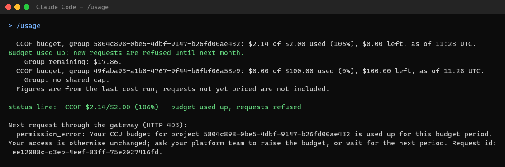

# 5. Developer setup

**Who:** each developer (or the device management team, with the same files) · **Time:** about 5 minutes ·
**Needs:** Claude Code installed, Git, Node.js 22, PowerShell 7, the Azure CLI when the configuration uses the
Azure CLI sign-in, membership of an onboarded group, and the client
configuration file that Stage 7 generated (`client-config.json`), handed over through the approved private channel.

Full details, macOS and Linux paths, Claude Desktop and VS Code: [CLIENTS.md](../CLIENTS.md).

## 0. Get the code

```powershell
cd $HOME; git clone https://github.com/naveenneog/CCOF.git ccof; cd ccof
```

Every command on this page runs from the `ccof` folder. A machine that already has the folder runs `git pull` in
it instead.

## 1. Install the helper and configure Claude Code

```powershell
npm ci --prefix .\client --no-audit --no-fund
$env:CCOF_CONFIG_FILE = (Resolve-Path '<client-config.json>').Path
pwsh -NoProfile -File .\scripts\client\Set-ClaudeCodeGateway.ps1 -ConfigPath $env:CCOF_CONFIG_FILE -Confirmed
```

Add `-UsageStatusLine` to show the budget continuously in Claude Code's status line.

**Expected:** one JSON line with `"event":"configured"`, `"usageSkill":true`, `"statusLine":"set"` (with
`-UsageStatusLine`), a `changeId`, the configuration's `"signInMethod"` and `"signIn"`, the sign-in command for
step 2. The previous settings are backed up under that `changeId`; to undo, see
[CLIENTS.md, Restore](../CLIENTS.md#restore). The settings file
then points Claude Code at the gateway (`ANTHROPIC_BASE_URL`) and the token helper (`apiKeyHelper`).


## 2. Sign in once

Run the `"signIn"` command from step 1. For Claude Code it is always:

```powershell
& "$env:USERPROFILE\.claude\ccof-token.cmd" login
```

What appears depends on the `"signInMethod"` the administrator chose:

| `signInMethod` | What appears | Needs |
| --- | --- | --- |
| `msal` (default) | Windows uses the signed-in work account (WAM); otherwise a browser window opens | Node.js 22 |
| `azure-cli` | A Microsoft sign-in window from the Azure CLI. **Expected:** `Signed in. Claude Code and Claude Desktop now use this sign-in.` | The Azure CLI (`az version` prints a version) |

No token is ever printed. With `azure-cli` the helper keeps its own Azure CLI profile, so an existing `az login`
for other work is not changed. The same helper also takes `status` (the signed-in account) and `logout`.

Claude Desktop: when its setup prints a `"signIn"` command (`azure-cli`, or an older Desktop with `msal`), run it
once before starting Desktop ([CLIENTS.md, section 3a](../CLIENTS.md#3a-azure-cli-sign-in-signinmethod-azure-cli)).
A newer Desktop with `msal` (`"credentialKind":"external-idp"`) prints none and asks for the sign-in itself
([CLIENTS.md, section 5](../CLIENTS.md#5-configure-claude-desktop)).

## 3. Use Claude Code

Start `claude` as usual. Requests go through the gateway with the models the group admits.

## 4. Check your own budget: `/usage`

In Claude Code, `/usage` prints each of your budgets, as of the last cost run (about a minute old):


With the example guard, from 80% of projected spend the line adds a warning and requests are slowed to reduce
overshoot. The threshold is configurable; reporting lag means this is not a strict dollar cap.


When recorded spend reaches the budget, new requests through that group are refused until next month or until the
budget is raised. Projected-spend refusal can clear earlier if the estimated in-flight spend falls.



What each figure means: [USAGE.md](../USAGE.md). `/cost` still shows the current session's own estimate.

## If something fails

| You see | Meaning |
| --- | --- |
| `401` | Sign in again: `& "$env:USERPROFILE\.claude\ccof-token.cmd" login` (step 2) |
| `azure_cli_sign_in` | The configuration uses the Azure CLI sign-in and something ran the repository's `ccof-token`; use the step 2 command |
| `azure_cli_missing` | Setup or `/usage` did not find the Azure CLI. Install it ([aka.ms/installazurecliwindows](https://aka.ms/installazurecliwindows)), open a new terminal, run step 1 again |
| `sign_in_required … AADSTSnnnnn` | Microsoft Entra refused the Azure CLI sign-in, for example `AADSTS53003` (Conditional Access). Give the code to the admin |
| `403 … surface_not_allowed` | The gateway enforces surfaces and the Azure CLI is not mapped; ask the admin ([guide 6.6](../STAGED-DEPLOYMENT-GUIDE.md#66-azure-cli-developer-sign-in)) |
| `403 … not entitled` | Not (yet) a member of an onboarded group; ask the admin |
| `403 … model family is not available` | Choose an allowed model (`/model`) |
| `403 … budget … used up` | Budget reached; ask the budget owner |
| `429` | A limit is reached; Claude Code retries; `/usage` shows whether the budget warning applies |

More: [troubleshooting](../operate/troubleshooting.md).
