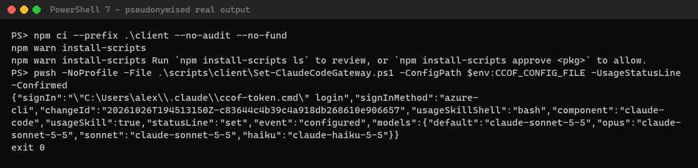
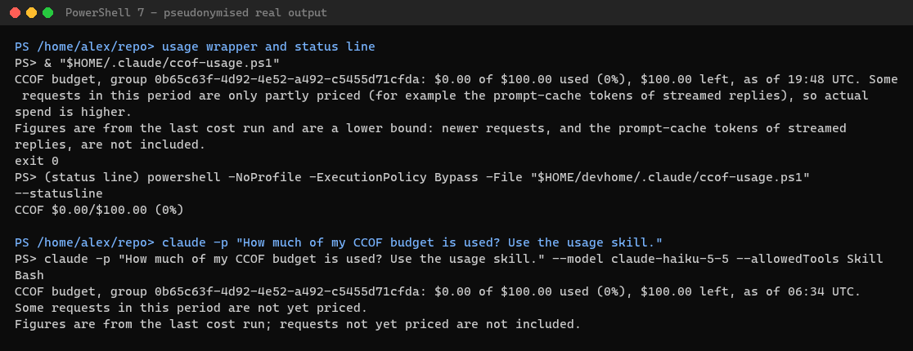

# Deployment day: set up the developers

Start after [the two-group checks](deployment-day.md) succeed. Each person needs direct Entra group membership,
Claude Code or the chosen client installed, and Stage 7's **`client-config.json`** from the admin through an
approved private channel. Never distribute access tokens or copy another person's sign-in cache.
Commands run from the `ccof` checkout in PowerShell 7 (`pwsh`); clone/install steps:
[developer setup](05-developer-setup.md). Times below are planning allowances unless a measured capture is named.

## 1. Claude Code — about 5 minutes per user

### Windows — about 5 minutes; setup capture not timed

Use the admin-generated config with **`signInMethod: azure-cli`**. Install Node.js 22+, PowerShell 7 and Azure CLI.
From the checkout:

```powershell title="Windows only"
npm ci --prefix .\client --no-audit --no-fund
$env:CCOF_CONFIG_FILE = (Resolve-Path '<client-config.json>').Path
pwsh -NoProfile -File .\scripts\client\Set-ClaudeCodeGateway.ps1 -ConfigPath $env:CCOF_CONFIG_FILE -Confirmed -UsageStatusLine
& "$env:USERPROFILE\.claude\ccof-token.cmd" login
claude -p "Reply OK." --model claude-haiku-5-5
```

Replace the model with the **deployed model** in your configuration, not a marketing name.
Setup returns JSON with `"event":"configured"`, `"signInMethod":"azure-cli"`, `"usageSkill":true`,
and `"statusLine":"set"` if no prior status line exists. It backs up previous settings.
The generated `ccof-token.cmd login` opens Microsoft sign-in through **its own Azure CLI profile**.
Expected: `Signed in. Claude Code and Claude Desktop now use this sign-in.` No token is printed.
Sign in as yourself, not as the deployment admin.



**Check the route and budget — about 2 minutes:** start `claude`; `/status` must show the gateway/models rather
than a hosted subscription route. In an **interactive** session choose the **CCOF** `/usage` entry, not Claude
Code's built-in entry. `claude -p "/usage"` is not this check. For a direct budget read:

```powershell
& "$HOME/.claude/ccof-usage.ps1"
```

The status line should show a figure such as `CCOF $0.00/$100.00 (0%)`. The local usage helper works even when
an exhausted budget prevents another model call. Wait for reconciliation before comparing new spend.
The captured novice model probe took **15 seconds**; that is not a general model-latency guarantee.



The usage screenshot combines a real 2026-10-26 usage-skill response with a 2026-10-27 wrapper/status-line capture.
It is **not** a new interactive `/usage` session tonight. [Usage limits and recovery](../USAGE.md).

### macOS/Linux — about 5 minutes; not captured tonight

Use PowerShell **7.4+**, Node.js 22+, Azure CLI and an `azure-cli` client config. Desktop's setup script is not
the route for these platforms. In `pwsh`, from the checkout:

```powershell
npm ci --prefix ./client --no-audit --no-fund
New-Item -ItemType Directory -Force ~/.config/ClaudeGateway | Out-Null
Copy-Item '<client-config.json>' ~/.config/ClaudeGateway/config.json
pwsh -NoProfile -File ./scripts/client/Set-ClaudeCodeGateway.ps1 -Confirmed -UsageStatusLine
```

Then in the user's shell run:

```sh
~/.claude/ccof-token login
claude -p "Reply OK." --model claude-haiku-5-5
```

The generated **`sh` helper** runs through `/bin/sh`; expected sign-in message:
`Signed in. Claude Code now uses this sign-in.` Its private Azure CLI profile is under
`~/.config/ClaudeGateway/az`. Do not reuse a Windows `.cmd` helper.
[Platform paths](../CLIENTS.md#macos-and-linux) · [ADR-0048](../adr/0048-claude-code-setup-on-macos-and-linux.md).

## 2. VS Code — about 2 minutes after terminal setup; not captured tonight

1. Run the same Claude Code setup **as the developer**. The extension reads the same Claude Code settings;
   setup also writes `claudeCode.environmentVariables` and **`claudeCode.disableLoginPrompt: true`** to VS Code's
   user settings. It writes no token there.
2. In VS Code run **Developer: Reload Window**. Open the **Claude Code** panel, not hosted claude.ai login.
3. Use **`/status`**, then a small prompt. Confirm the configured gateway/model and correlate its request in
   CCOF's group chargeback. An extension opening is not proof of the route.
4. If it asks for hosted login, inspect higher-priority managed/project settings; do not paste a personal API key.

Source: [CLIENTS, section 4](../CLIENTS.md#4-configure-claude-code-and-vs-code).

## 3. Claude Desktop — about 5 minutes; native reply not verified tonight

**Windows only for CCOF's script today; macOS Desktop setup is not supported.** Vendor Desktop capabilities
are broader; do not mistake those for this repository's tested installer.
From the checkout, as the developer:

```powershell title="Windows only"
$env:CCOF_CONFIG_FILE = (Resolve-Path '<client-config.json>').Path
pwsh -NoProfile -File .\scripts\client\Set-ClaudeDesktopGateway.ps1 -ConfigPath $env:CCOF_CONFIG_FILE -Confirmed
```

The script inspects the installed Desktop build's supported configuration; it refuses incompatible managed
inference policies rather than writing ignored settings. If setup prints a **`signIn`** command, run that
exact command. Newer external-IdP builds may ask for sign-in inside Desktop instead; do not force helper mode.

**Quit through the tray menu**, restart, open **Settings → Connection** (or the installed build's third-party
inference configuration), and select the CCOF profile. Check **Gateway**, your `/anthropic` URL, correct models,
and the script-selected credential kind. Send **Reply OK**; require a native reply and matching CCOF chargeback.
No native Desktop screenshot/reply was captured tonight. CLI `/usage` is not a Desktop chat feature.
[CLIENTS, section 5](../CLIENTS.md#5-configure-claude-desktop).

## 4. Cowork and Microsoft 365 — not timed; not verified with CCOF

**Group permissions do not install or route a client.** CCOF group `surfaces` can include `chat`, `code`,
`cowork`, `m365`, `design`. Checks apply **only when the rendered gateway's `entra.surfaceClients` is nonempty**.
The authenticated token's client application ID supplies the surface, not a user header.

The staged config input is **`gateway.surfaceClients`**, which Stage 5 renders to `entra.surfaceClients`.
For example, after the Office client has separately been admitted by the gateway's token policy, merge:

```json
{
  "gateway": {
    "surfaceClients": [
      { "clientAppId": "04b07795-8ddb-461a-bbee-02f9e1bf7b46", "surface": "code" },
      { "clientAppId": "00000000-0000-4000-8000-000000000010", "surface": "m365" }
    ]
  }
}
```

The first ID is the public Azure CLI client; the second is **hypothetical**. Obtain the actual Office client ID
from the approved add-in's Entra registration, not its display name. Allow `m365` in the relevant group's
`surfaces` alongside `code`; preserve its other fields. **Map every other admitted client too**, including
Desktop/chat clients if used: once mapping is enabled an unmapped client is refused. Mapping alone never
grants token admission or group membership.
[Gateway surfaces](../GATEWAY.md) · [ADR-0034 decision 6](../adr/0034-group-centric-onboarding.md).

**Cowork:** the CCOF console currently says **“Runs on Anthropic's servers; not routed through this gateway”**.
Treat this as a **CCOF onboarding limitation**, not a universal statement about today's Cowork architecture.
Current [vendor Cowork docs](https://claude.com/docs/cowork/overview) describe local-computer work, and
[Desktop managed configuration](https://claude.com/docs/third-party/claude-desktop/configuration) exposes
gateway/Cowork settings. **No Cowork-through-CCOF test or installer is provided here.**
Do not advertise Cowork as covered by this deployment or assume `ANTHROPIC_BASE_URL` configures it.

**Office add-ins:** current [Anthropic M365 documentation](https://claude.com/docs/office-agents/third-party-platforms)
does support third-party LLM gateways and Foundry direct. It uses add-in-specific settings such as
`gateway_url`, `gateway_auth_source=entra` and `azure_base_url`, not the terminal's environment variables.
**Foundry direct bypasses CCOF accounting.** The vendor setup wizard does not establish CCOF token-audience,
client-admission or model compatibility by itself. Use an approved gateway/Entra configuration and test on
one device: authenticated call, correct model, selected group/surface, ledger and budget.
Do not put a shared token or Foundry key in an add-in manifest.

CCOF's surface authorization has automated tests, **not an Office add-in live acceptance result**.
No M365 live request/capture was made tonight. Microsoft's
[Foundry Claude guide](https://learn.microsoft.com/azure/foundry/foundry-models/how-to/use-foundry-models-claude)
verifies Messages API/Entra authentication, not CCOF add-in support.
Vendor pages checked **2026-10-27**; [evidence boundary](../adr/0055-deployment-day-evidence-boundary.md).

## 5. Bulk onboarding — not timed; no Intune tenant used tonight

**This is a vendor-documented deployment pattern, not a live-tested CCOF Intune package.**
Pilot it before fleet assignment. Device installation can be bulk; **per-user interactive sign-in cannot**.
Never run one admin's `az login` and copy its cache to 25,000 devices.

### Large-group membership — not timed; finish the access plan first

Intune installs software; it does not admit members to CCOF. Prefer approved automatic Graph sync for large
groups, or an approved large-snapshot runner/transport ([sync](../SYNC.md)). The app-settings helper accepts
only **7,000 base64** characters on Windows (96 KiB helper limit elsewhere); never omit people to fit it.
New managed identities appear in Stage 1; Graph grants can take up to 24 hours to become effective.
For a hard 2–3 hour window, pre-provision core resources/consent early or approve a tested alternative.
The live two-membership snapshot was a pilot, not 25,000-member transport proof.

### Device payload — not timed

1. Use Intune **Win32 app/Platform scripts** to install approved Claude Code, Node.js 22+, PowerShell 7,
   Azure CLI, the pinned CCOF client package **and its dependencies**, and the approved client config.
   Keep the package location persistent; generated wrappers reference its installed Node/client entry paths.
2. Run the normal CCOF setup **in each user's context**, not SYSTEM's profile, to install that user's
   `ccof-token.cmd`/`sh` helper, usage skill and settings. Do not copy one user's generated config/cache.
3. Deliver managed settings as SYSTEM/admin to **`C:\Program Files\ClaudeCode\managed-settings.json`**,
   or the JSON `Settings` value at `HKLM\SOFTWARE\Policies\ClaudeCode`.
   On macOS use **`/Library/Application Support/ClaudeCode/managed-settings.json`** or a configuration profile
   in `com.anthropic.claudecode`. Linux uses `/etc/claude-code/managed-settings.json`.
4. Build policy values from the actual output of CCOF's setup, **not a second model list**. These are the keys
   its [setup implementation](../../scripts/client/ClaudeCodeGateway.ps1) writes; example Windows policy:

```json
{
  "apiKeyHelper": "\"%USERPROFILE%\\.claude\\ccof-token.cmd\" token",
  "model": "claude-sonnet-5-5",
  "env": {
    "ANTHROPIC_BASE_URL": "https://contoso-gateway.azure-api.net/anthropic",
    "ANTHROPIC_MODEL": "claude-sonnet-5-5",
    "ANTHROPIC_DEFAULT_OPUS_MODEL": "claude-sonnet-5-5",
    "ANTHROPIC_DEFAULT_SONNET_MODEL": "claude-sonnet-5-5",
    "ANTHROPIC_DEFAULT_HAIKU_MODEL": "claude-haiku-5-5"
  }
}
```

Replace URL/aliases from **your generated config**. Here `%USERPROFILE%` is expanded by Windows' command shell;
verify it resolves to the signed-in user on the pilot. The normal installer writes an absolute quoted path.
For macOS/Linux the equivalent helper command is `"\"$HOME/.claude/ccof-token\" token"` (shell expansion);
test paths with spaces. Never assign one user's absolute path to the fleet.
Preserve your approved security policy and remove conflicting provider/static-credential settings through the
same policy owner; per-user settings cannot override managed policy.

Sources checked 2026-10-27: [managed settings](https://code.claude.com/docs/en/managed-settings),
[vendor MDM examples](https://github.com/anthropics/claude-code/tree/main/examples/mdm)
(vendor labels these community-maintained templates), and
[Intune PowerShell scripts](https://learn.microsoft.com/intune/intune-service/apps/powershell-scripts).
The vendor Windows example writes the file path above; ADMX uses the registry path. Delivery success alone
does not prove helper installation, authentication or gateway routing.

### Each person's first sign-in and pilot test — about 5 minutes

1. As the user, run `ccof-token.cmd login` or `~/.claude/ccof-token login`; this performs their own **`az login`**
   in the helper's private profile. Conditional access/MFA can add time.
2. Start Claude Code; **`/status` → Setting sources** must include **Enterprise managed settings (file)**,
   or the actual registry/profile source. Check the gateway/model route.
3. `claude -p "Reply OK." --model <admitted-deployment>` must answer through CCOF, and the admin must find its
   correlation ID charged to the expected group. Check interactive CCOF `/usage` and the status line.
4. Repeat with a second user/profile and both groups; test denied model, sign-out/re-sign-in, reboot and rollback.
   Only then assign a small cohort and observe quotas, budget lag and errors before expanding.

**Desktop bulk:** vendor [Desktop managed-config documentation](https://claude.com/docs/third-party/claude-desktop/configuration)
exists, but it is a separate schema—not Claude Code's `managed-settings.json`. CCOF's Desktop script deliberately
refuses an overriding managed inference policy. No fleet-managed Desktop deployment was tested; use the approved
per-device Windows script route until a separate managed Desktop pilot verifies the provider/credential settings.
Intune, macOS profiles, VS Code native UI, Desktop native replies, Cowork and Office screenshots are **not captured**
here; existing terminal captures are labelled with their real source run.
