# Deployment day: HA and two groups

**Who:** deployer, Entra approver, network owner and group admins.
**Window:** 2–3 hours **after** advance checks; not a deployment-time or 25,000-developer capacity guarantee.
Use [stage instructions](03-deploy.md). Keep private config and `.staged-state` together; never commit tokens/real IDs.

**Fill in your configuration:** [choose each option and copy the complete HA example](deployment-day-config.md)
before running stages. It explains where to find each value and the approved nonzonal Cosmos alternative.
For terminal, VS Code, Desktop and the unverified bulk/Office paths, use
[developer and fleet onboarding](deployment-day-users.md).

## Before the day — finish with the named owner

- [ ] **The subscription Owner:** approve the resource group, costs, quota requests and deployer's Contributor
  plus Role Based Access Control Administrator access. Activate time-limited roles before starting.
- [ ] **Entra owner:** arrange Stage 4 with an Application Administrator or the owners of the existing
  gateway, resolver and admin app registrations. Identify the **Privileged Role Administrator** who approves
  Graph application consent if automatic sync, group search or names are wanted
  ([permissions](../STAGED-DEPLOYMENT-GUIDE.md#61-graph-grants-group-search-names-and-sync)).
  Otherwise approve snapshot transport for the group size. New managed-identity Graph grants can take **24 hours**;
  admin role tokens can take **60–90 minutes** to refresh. Do not book these waits inside the window.
- [ ] **Model/quota owner:** run the [quota and model commands](02-prerequisites.md#microsoft-foundry-models)
  in **each Foundry subscription**, using its account region. Record free quota **per model/version and
  Global or Data Zone pool**, not one total. Accounts/regions in the same subscription share Claude quota.
  Ask for RPM and TPM for the planned model mix, peak demand and failover headroom
  ([sizing and request worksheet](../operate/sizing.md)). The prerequisite examples of 80 Sonnet Global
  capacity or 27 Haiku Data Zone capacity are examples, **not sufficient quota for 25,000 developers**.
  Confirm primary and standby deployments, purchase rights and data-processing geography.
- [ ] **Cosmos owner:** obtain **zone-redundant capacity for the intended region/subscription** via
  <https://aka.ms/cosmosdbquota>. Central India refused zonal creation twice in the HA lab; regional zone
  support is not capacity approval. Without approval, full zonal Cosmos is a **no-go**: arrange an explicit
  owner-approved alternative before the day, not repeated immediate retries
  ([safe recovery](high-availability.md#3-add-the-options-before-stage-1)).
- [ ] **Network/APIM owners:** approve network design, DNS/routing, machine access and permissions.
  In `verify` mode, connect new resources after Stage 1 and before Stage 6; keep the network owner present.
  Production uses the customer network in `verify` mode; `create` is the lab route.
  A private Foundry standby needs its own approved endpoint/DNS path. An existing APIM owner manages its
  zones, units and VNet and approves CCOF's additions
  ([network](../NETWORK.md), [existing APIM](existing-api-management.md)).
- [ ] **Deployer:** on Windows or macOS, install **PowerShell 7** (7.4+ on macOS), Azure CLI with Bicep,
  **Node.js 22+**, npm and Git. Use a **persistent** local/managed deployment folder, not ephemeral
  **Cloud Shell**. Verify tools, sign-in, `npm ci --ignore-scripts --include=dev`, and access from that
  machine to private app/SCM endpoints. Save backups through the approved private channel.
- [ ] **Deployer + group admins:** draft the full [configuration](configuration.md), including exact
  deployed model IDs/client aliases, two existing Entra security-group Object IDs, budgets and cost codes.
  Run **Stage 0 clean**; resolve refusals and review HA/quota suggestions. Arrange **three developers**,
  including one direct member of both groups, for the acceptance checks. Do not create test identities
  or add Entra memberships without approval.

## HA starting settings for a 25,000-developer rollout

Merge into the **full** config **before Stage 1**; this fragment is not deployable by itself:

```json
{
  "location": "centralindia",
  "ha": {
    "apim": { "zoneRedundant": true },
    "functions": { "zoneRedundant": true }
  },
  "stage1": {
    "apimSku": "StandardV2",
    "apimUnits": 4,
    "storageSku": "Standard_ZRS",
    "cosmosCapacityMode": "provisioned",
    "cosmosLocations": [
      { "locationName": "centralindia", "isZoneRedundant": true },
      { "locationName": "southindia", "isZoneRedundant": false }
    ]
  },
  "cosmos": {
    "capacityMode": "provisioned-autoscale",
    "autoscaleMaxThroughput": 1000
  }
}
```

The Cosmos throughput above is the template's **initial** shared database maximum, not a 25,000-user sizing
result; monitor throttles and size it to measured sync/reconciler demand. South India is the paired region
and has no zones. Enable Central India Cosmos zones only where capacity is granted.
For an existing APIM, **omit `ha.apim`** and have its owner supply the equivalent capacity/protection.
Stage 1 is create-only: adding these keys does not upgrade an already-deployed stack.

Add **`backends[].failover`** for a matching standby Foundry account in another Claude region, preferably
another subscription in the same tenant; for a new CCOF-created standby also use
**`stage1.foundry.failover`**. Copy the full, matching descriptors from
[Foundry failover](foundry-failover.md#2-add-the-configuration), including private endpoint settings.
One subscription does not gain quota by adding an account. Claude is not offered in India; obtain approval
for prompt processing outside India ([regions](region-and-failover.md)).

**Costs and limits:** four APIM units are an initial rollout setting, **not a 25,000-developer load test**.
The [sizing worksheet](../operate/sizing.md) explains the unproven scale-out and stream assumptions.
Watch **`CpuPercent_Gateway`**, not Standard v2's unpopulated `Capacity` metric; ramp in cohorts.
The [HA cost table](high-availability.md#1-what-to-protect-and-what-it-costs) gives Central India list rates:
first APIM unit USD 0.95890/hour, additional units USD 0.68493/hour, plus zonal Functions' at least two
always-ready instances per scaling function/group, ZRS, Cosmos and logs. See
[Cosmos two-region examples](region-and-failover.md#2-provisioned-cosmos-db) and
[standby endpoint costs](foundry-failover.md#limits-and-cost). These are not a complete bill.
APIM v2/Functions remain single-region; Foundry endpoint failover does not rescue a lost gateway region.

## On the day — reserve 80–100 minutes for stages, then people and retries

Successful applies in the Central India labs on **2026-10-26/27** took about **73 minutes**.
Allow 80–100 minutes with previews/variation; failures and approvals are extra. Measured times appear below.

| Stage | What happens | Allow | Check before continuing |
| --- | --- | --- | --- |
| 0 | Preflight/read-only | 1–3 min | No refusals; review quota/HA report |
| 1 | Resources | 5–10 min | APIM zones/4 units, Flex zones, ZRS and approved Cosmos regions read back |
| 2 | Cosmos schema | 4 min | Database and containers verified |
| 3 | Runtime roles | 7–15 min | Role read-backs succeed |
| 4 | Entra registrations/groups | 1 min | Approver present; approved apps reused/created |
| 5 | Settings, gateway policy, telemetry | 2 min | Correct backend deployments and standby pool |
| 6 | Private network | 12–15 min | Endpoint approval, DNS and integrations verified |
| 7 | Publish apps, seed, sync, client export | 20–25 min | Successful sync, zero write failures, client config generated |
| 8 | Acceptance | 5 min | Anonymous 401, allowed model 200, denied model 403, usage trace found |

From the repository folder in `pwsh`, set `$cfg` to the private config and run Stage 0 once:

```powershell
$cfg = Join-Path $HOME 'ccof-private/staged.config.json'
$run = 'infra/staged/Invoke-StagedDeployment.ps1'
pwsh -File $run -Stage 0 -ConfigPath $cfg
$stage = 1
pwsh -File $run -Stage $stage -ConfigPath $cfg
# STOP: read the preview; apply only if the proposed changes are approved.
pwsh -File $run -Stage $stage -ConfigPath $cfg -Apply
```

Repeat the last two commands with `$stage = 2`, then **3, 4, 5, 6, 7, 8**, one at a time.
Do not run the next stage after an error. Re-run the failed stage's preview/apply with the **same state folder**;
follow any named dependency. **Stage 7 storage 403:** wait **5 minutes**, then rerun Stage 7.
If it persists, check storage roles/network rather than repeatedly publishing. Cosmos zonal refusal means stop
and follow the approved recovery, never mark completion yourself.
[Stage troubleshooting](../STAGED-DEPLOYMENT-GUIDE.md#stage-8-acceptance) ·
[operating troubleshooting](../operate/troubleshooting.md).

**Script output:**

```text
preview only: nothing changed
completed and verified in
HA check:
```

These are printed fragments, not complete logs; preview is not success.
For Stage 7 require a `ccof.sync.run.v1` record with `"outcome":"succeeded"` and `"writeFailures":0`;
finish only after Stage 8's completion/read-back.

### Stage 0 — about 1–3 minutes; measured 74 seconds
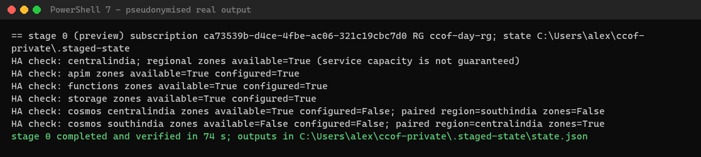

### Stage 1 — about 5–10 minutes; measured 538 seconds
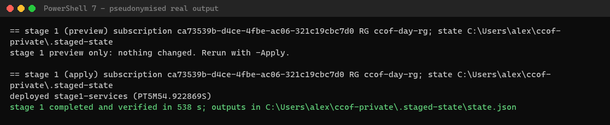

### Stage 2 — about 4 minutes; measured 259 seconds


### Stage 3 — about 7–15 minutes; measured 845 seconds


### Stage 4 — about 1 minute; measured 63 seconds
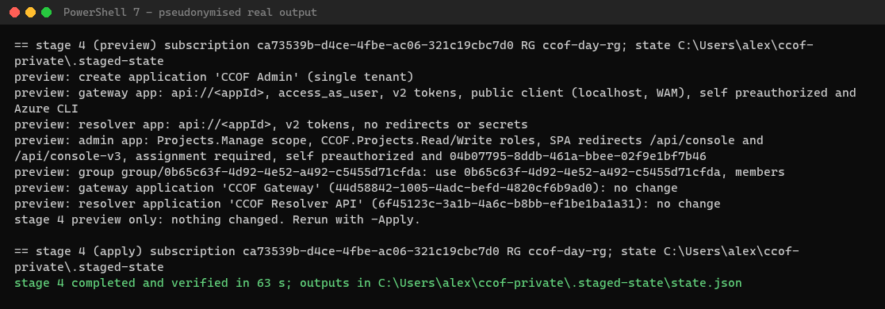

### Stage 5 — about 2 minutes; measured 119 seconds
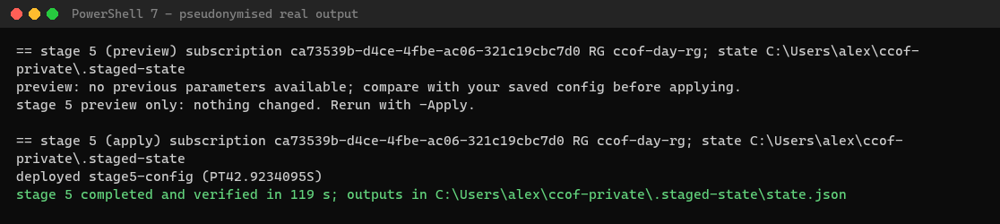

### Stage 6 — about 12–15 minutes; measured 879 seconds
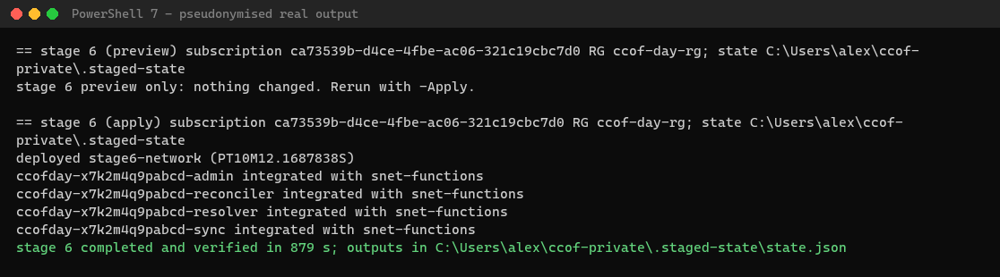

### Stage 7 — about 20–25 minutes; measured 1,286 seconds
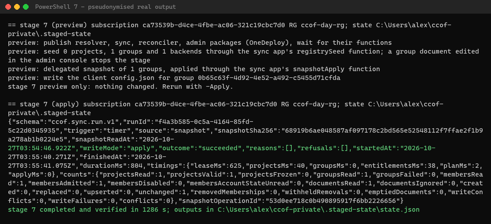

### Stage 8 — about 5 minutes; measured 296 seconds
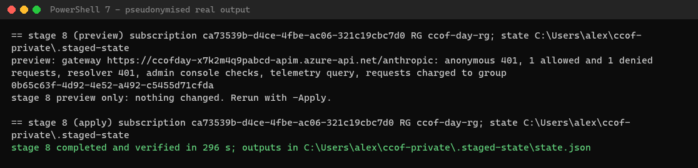

Real 2026-10-27 HA logs; previews not timed. [Sources and proof limits](../evidence/2026-10-28-deployment-day/README.md).

## Onboard and prove two groups — reserve 30–45 minutes

1. **Groups → Onboard a group:** follow [the four steps](04-onboard-a-group.md) for two existing groups.
   Search the directory or paste Object IDs if search is disabled; select a backend/model returned by
   `/api/groups/backends`, distinct chargeback IDs and approved per-user/group budgets.
   Expected: both groups **active** in Groups (API `GET /api/groups` returns **200**; new onboard returns **201**).
   Scripted admins use the [Azure CLI sign-in and API contract](../ADMIN-API.md#sign-in), not a copied browser token.
2. **Apply membership:** automatic mode needs the next **successful** sync. Snapshot mode needs a **fresh snapshot
   containing all registered group IDs**, not just the new one; use the complete
   [snapshot procedure](../operate/users-and-groups.md#snapshot-mode-after-console-changes).
   A Stage 7 rerun alone omits console-added groups. Expect a succeeded run, zero write failures and both
   memberships admitted. Allow up to two minutes for gateway cache expiry.
3. **Developer in both groups:** send a small allowed-model request with
   **`x-ccof-project: <first-group Object ID>`**, then with the second Object ID.
   Expected: **200** for both. Make one more request with **no selector**: it must charge the group with
   the higher **month-to-date personal spend**, then the lower priority number on a tie—not the larger budget.
   An exhausted default group is refused; there is no automatic switch.
   If rerunning Stage 8, update `acceptance.expectedGroup` to the verified no-selector group; it does not select routing.
4. **Negative test:** request a model admitted by the first group but not the second, selecting the second.
   Expected: **403**, with that group's allowed models. Both groups must also have at least one working model.
   If only one deployment exists, record the missing differential-model coverage; do not invent a deployed model.
5. **Account for it:** after reconciliation, `GET <gateway>/anthropic/ccof/me/usage` returns **200** and both
   budgets; [developer `/usage` and the local usage helper](05-developer-setup.md#4-check-your-own-budget-usage)
   show the same figures. Check **Chargeback → by group**, then the Usage CSV or Log Analytics usage trace:
   each successful request's correlation ID must identify its selected group and cost code.
   [Chargeback checks](../operate/chargeback-and-tags.md) explain token costs and reporting lag.
6. **Console:** Groups lists both; **Budgets → Snapshots** for each opens that **group's** page, not Legacy
   projects; Chargeback by group shows both after telemetry arrives. Repeat successful calls and accounting
   with the other **two developers' own sign-ins**. Three calls by one developer are not three developers.

### Two-group onboarding — about 30–45 minutes; individual calls measured below
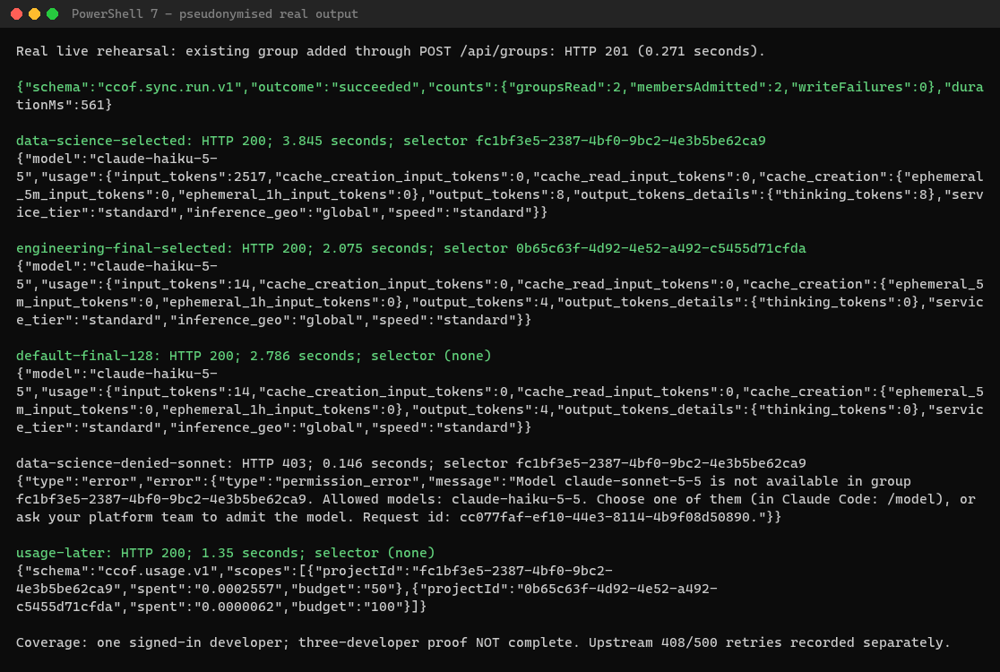

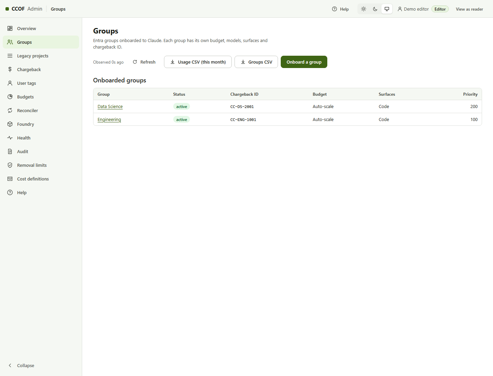
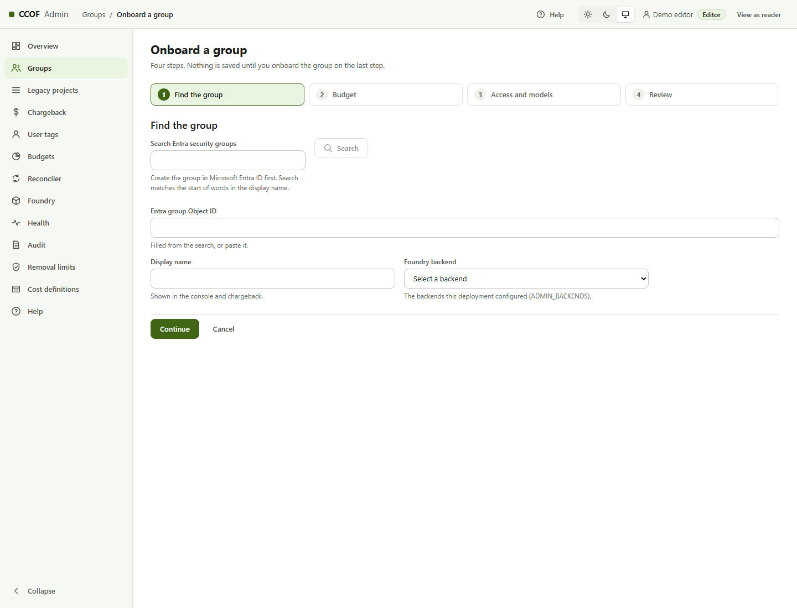
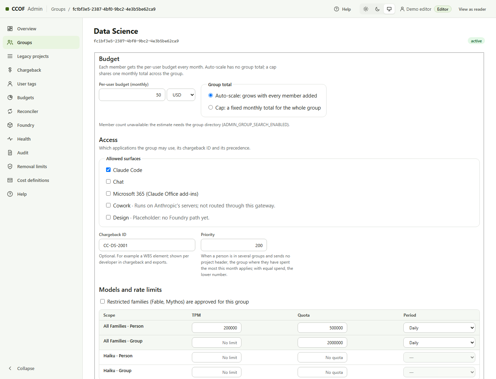
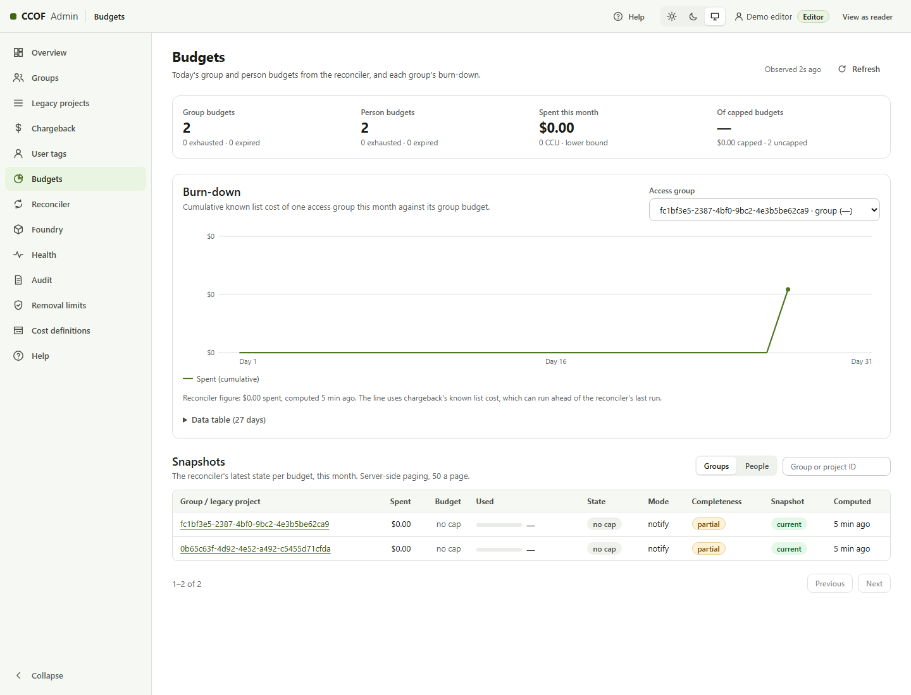
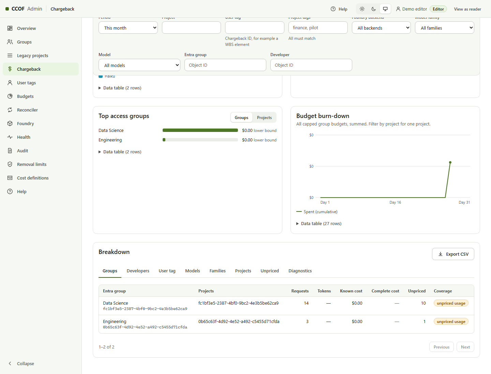

### Developer setup — about 5 minutes per user; captured setup not timed


Follow [client-specific steps](deployment-day-users.md). These earlier screens are not tonight's three-developer proof.

**Done means:** Stage 8 **PASS**, two active groups synced, **three developers' requests charged correctly**,
both budgets and `/usage` correct, and console links checked. Preserve request IDs/results privately.
If any check is missing, record the blocker and keep rollout closed. Tonight's rehearsal cannot replace
customer quota approval, full zonal Cosmos capacity or a representative 25,000-developer capacity test.
