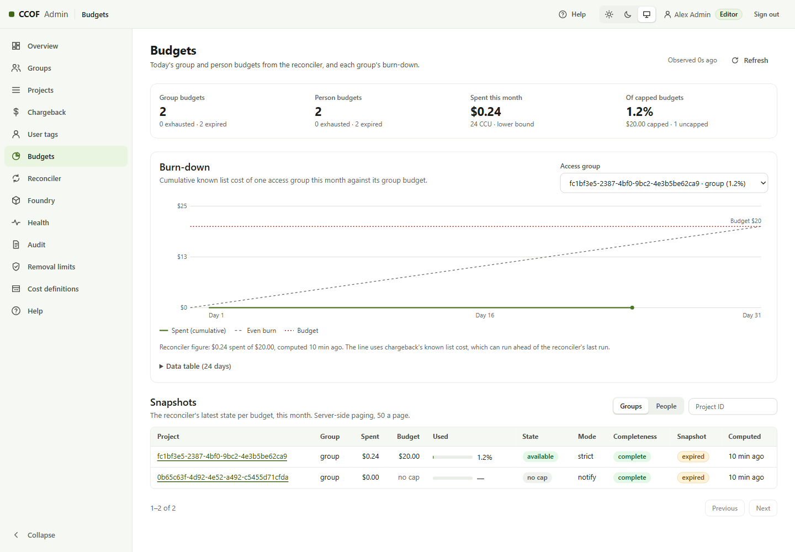

# Budgets and the budget guard

## What is enforced

With `resolver.budgetEnforcement: budget-state`, each person has a monthly budget per onboarded group:

- **Auto-scale:** every member gets the per-user budget; the group has no total.
- **Cap:** every member gets the per-user budget, and all members together are limited to the group cap.

The reconciler prices usage at the rate card about every minute ([COST-MODEL.md](../COST-MODEL.md)). When recorded
spend reaches the budget, new requests through that group are refused (`403`) until next month or a budget change.
With `token-limits-only`, budgets are shown but not enforced ([guide 6.5](../STAGED-DEPLOYMENT-GUIDE.md#65-token-limits-are-not-dollar-enforcement)).

## The budget guard (warning at 80%)

Recorded spend trails actual spend by about two minutes (Log Analytics ingestion and one reconciler run). Without a
guard, a fast user overshot a USD 10 budget by 12.5% recorded and 19.7% at list price in a live test. The budget
guard ([ADR-0040](../adr/0040-budget-guard.md)), set in `reconciler.budgetGuard`:

| Setting | Example | Effect |
| --- | --- | --- |
| `warnPercent` | 80 | From 80% of **projected** spend (recorded plus the last five minutes' rate over the lag), the person sees a warning and requests are slowed to reduce overshoot |
| `overshootPercent` | 5 | The spend rate is limited at all times, so spend not yet recorded stays near 5% of the budget |
| `projectionMinutes` | 5 | The lag the projection covers |

Live result with the guard: a USD 14 budget under the same load ended at USD 13.84, 1.1% under
([evidence](../status/BUDGET-ACCEPTANCE-2026-10-23.md)). In the 2026-10-24 demo lab, with `overshootPercent` 25, a
USD 2 per-user budget under three parallel Sonnet clients ended at USD 2.14, 7% over
([evidence](../evidence/2026-10-24-demo/README.md#budget-run)).

The rate limit grows with the budget: 5% of USD 100 over 5 minutes is USD 1 per minute; of USD 1,000, USD 10 per
minute. A budget owner who needs faster spending of a small budget raises `overshootPercent`.

The guard controls a rate, not an atomic dollar reservation. Delayed telemetry, cached decisions and in-flight
requests can still cause overshoot; `overshootPercent` is not a guaranteed maximum.

## What people see

| State | `/usage` | Status line |
| --- | --- | --- |
| Normal | `$42.10 of $100.00 used (42%), $57.90 left` | `CCOF $42.10/$100.00 (42%)` |
| Warning | `… Warning: about 85% of this budget is used or in progress; requests are now slowed …` | `… - warning: about 85% used, slowed` |
| Reached (projected) | `… Projected spend has reached this budget: new requests are refused …` | `… - budget reached, requests refused` |
| Used up (recorded) | `… Budget used up: new requests are refused until next month.` | `… - budget used up, requests refused` |

## Model-family limits

Each group can limit tokens per minute and per day for a person and for the whole group, per family (for example
Haiku 50,000 tokens per minute per person). These are token limits, not dollar budgets; a request over a limit gets
`429` with `Retry-After`.
