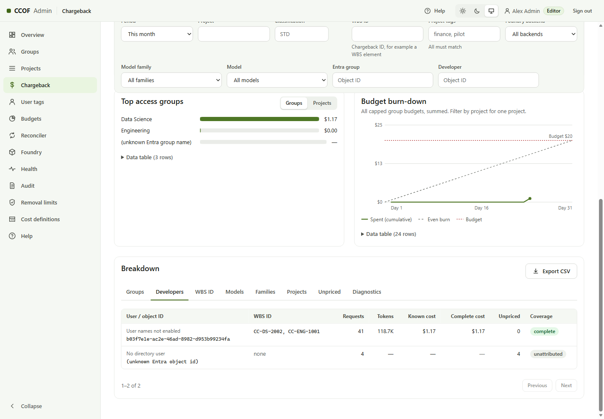
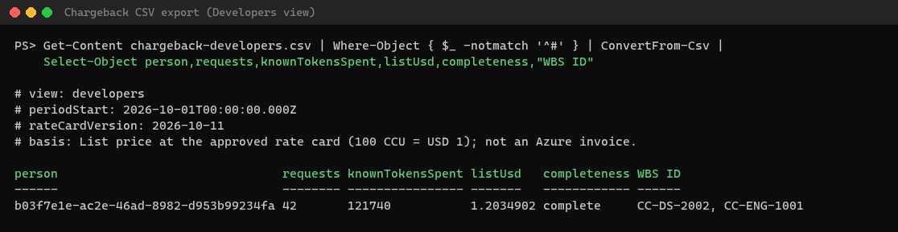

# Chargeback and user tags

Every request is charged to one cost code:

1. the person's **user tag**, when the admin has tagged them; otherwise
2. the onboarded group's **chargeback ID**.

## Name the field and tag people

Admin console → **User tags**:

1. **Tag field name** — one name for the deployment, for example **WBS ID**. It is used in the console, the filters and
   the CSV header. JSON and Power BI keys stay `chargebackId` and `userTag`.
2. **Tag a person** — choose an onboarded group's member (or paste an Object ID), type the value, **Save tag**.
   Values saved before are suggested as you type.

A new tag reaches requests at the next sync (automatic mode) or snapshot (snapshot mode); requests before that keep
the group's chargeback ID.

## Reports

Admin console → **Chargeback**: filter by period, group, model, family, developer or the tag field; the breakdown
tabs are Groups, Developers, the tag field (for example **WBS ID**), Models, Families, Projects, Unpriced and
Diagnostics. **Export CSV** downloads the current tab with the field name as the column header.

Costs are list price at the approved rate card (100 CCU = USD 1), less any recorded private-offer discount; they are
not an Azure invoice. Power BI and the workbook: [CHARGEBACK.md](../CHARGEBACK.md).
