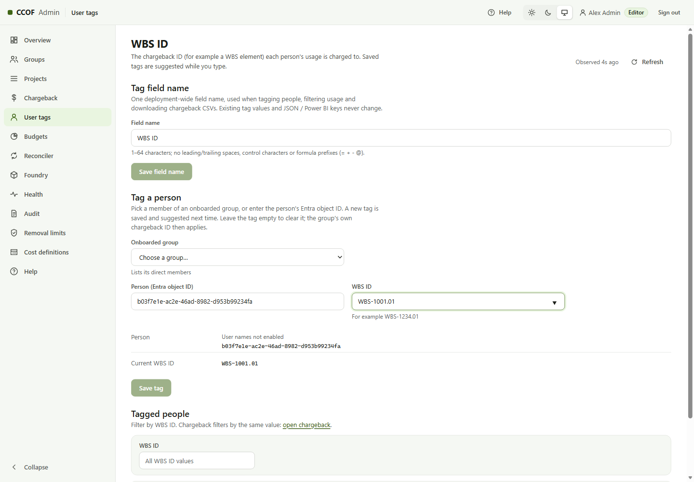
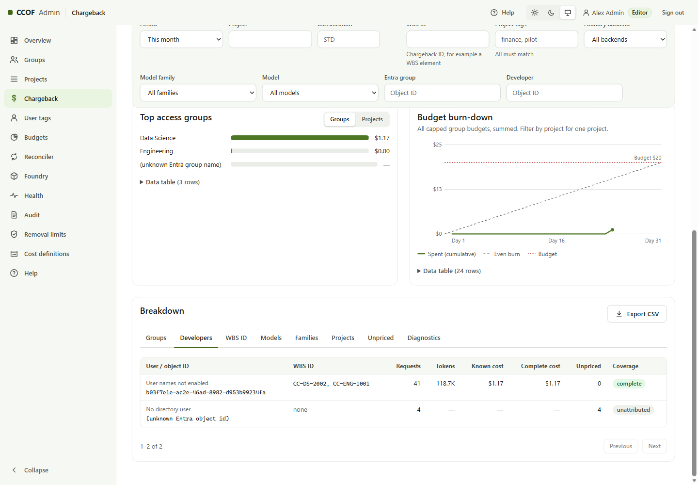
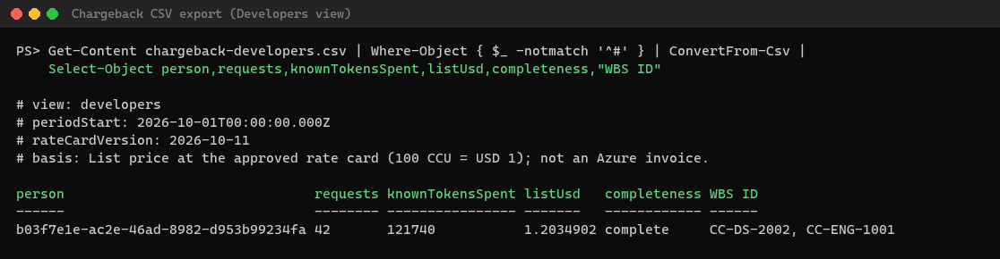

# Chargeback and user tags

Every request is charged to one cost code:

1. the person's **user tag**, when the admin has tagged them; otherwise
2. the onboarded group's **chargeback ID**.

## Name the field and tag people

Admin console → **User tags**:

1. **Tag field name** — one name for the deployment, for example **WBS ID**. It is used in the console, the filters and
   the CSV header. JSON and Power BI keys stay `chargebackId` and `userTag`.
2. **Tag a person** — choose an onboarded group's member (or paste an Object ID), type the value, **Save tag**.
   Values saved before are suggested as you type.

A new tag reaches requests at the next sync (automatic mode) or snapshot (snapshot mode); requests before that keep
the group's chargeback ID.

## Reports

Admin console → **Chargeback**: filter by period, group, model, family, developer or the tag field; the breakdown
tabs are Groups, Developers, the tag field (for example **WBS ID**), Models, Families, Projects, Unpriced and
Diagnostics. **Export CSV** downloads the current tab with the field name as the column header.

Costs are list price at the approved rate card (100 CCU = USD 1), less any recorded private-offer discount; they are
not an Azure invoice. Power BI and the workbook: [CHARGEBACK.md](../CHARGEBACK.md).

## History beyond Log Analytics retention

The reports read the usage ledger in Log Analytics, which keeps it for the workspace retention
(`stage1.retentionInDays`, 30 in the template). With `audit.chargebackHistory.enabled`
([configuration](../get-started/configuration-reference-3.md#chargeback-history), [ADR-0044](../adr/0044-chargeback-history-in-cosmos.md)):

- **What is kept.** The reconciler writes one document per UTC day, tag value, group, person and model to the
  Cosmos DB container `chargebackDaily`: request counts, token totals and the list-price amount
  (`src/reconciler/history.ts`). The tag value is the one each request carried, as in the reports.
- **When a day is final.** A day closes `closeAfterDays` whole days after it ends; later ledger rows for it are not
  added. Until then its document is refreshed at most once an hour. A total is never lowered.
- **Which export uses it.** **Export** of usage (`/api/v3/export/usage`, CSV or JSON) for a period that starts before
  the first whole month the workspace still holds reads that part from `chargebackDaily` and the rest from Log
  Analytics, one row per tag value, group and person (`admin/src/history.ts`). The current month always comes from
  Log Analytics. The CSV header uses the tag field name. The console tabs and the workbook still show only what the
  workspace holds.
- **What history does not hold.** Per-request diagnostics: failed requests, duplicate copies, cache savings and the
  backend. Those columns are empty for history rows, and a backend filter is refused for those months. A history
  period must start and end at 00:00 UTC.
- **How long.** `ttlDays` null keeps documents until someone deletes them; a number deletes each day that many days
  after its last write. Days before history was turned on are not in it.

Example: on a hypothetical 19 October with 30-day retention, **previous month** (September) comes from history; a
custom range 15 September to 10 October reads 15-30 September from history and 1-10 October from Log Analytics.
