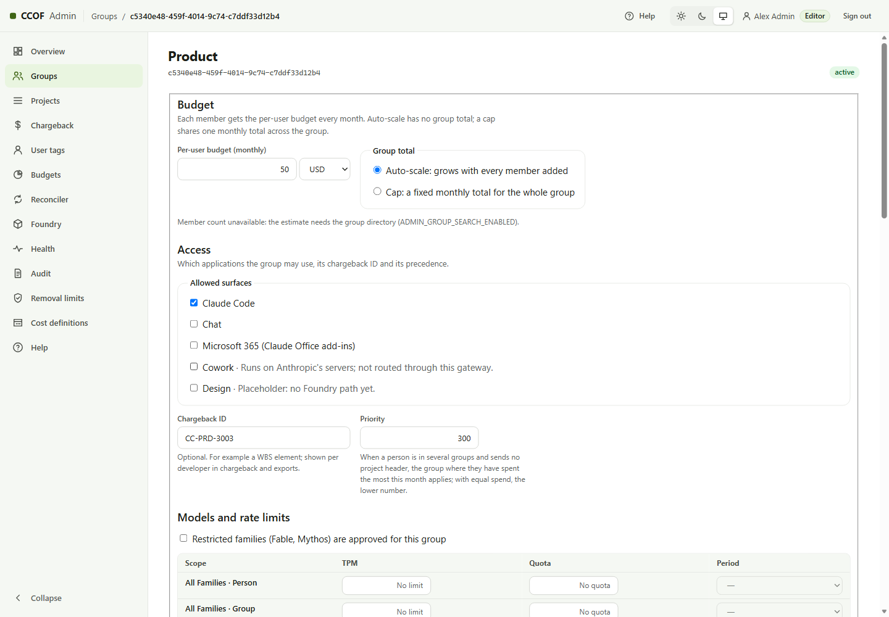

# Users and groups

Entra is the source of truth for who has access. CCOF never adds, removes or changes Entra group members.

## How membership reaches CCOF

| Mode | Set by | When a change takes effect |
| --- | --- | --- |
| **Automatic** | Graph permission `GroupMember.Read.All` (and `User.Read.All`, `Application.Read.All`) granted to the sync identity, `syncTimerEnabled: true` | At the next successful scheduled sync ([SYNC.md](../SYNC.md)) |
| **Snapshot** | No Graph application permission (`sync.mode: delegated-snapshot`) | When an operator applies a fresh snapshot including all registered group IDs; procedure below |

Granting the permissions: [guide 6.1](../STAGED-DEPLOYMENT-GUIDE.md#61-graph-grants-group-search-names-and-sync).
Managed identity tokens are cached for up to 24 hours, so a new grant can take that long to apply.

Only **direct user members** of an onboarded group are counted; nested groups, devices and service principals are not.

## Common tasks

| Task | Where | Result |
| --- | --- | --- |
| Give a person access | Add them to the Entra group | Access at the next sync; their own budget from that group |
| Remove a person | Remove them from the Entra group | Access ends at the next sync. A sync removes at most `maxRemovalsPerRun` people (and `maxRemovalFraction`) per run, so a mistaken mass removal is held back for review |
| Move a person between teams | Change their Entra groups | Each group keeps its own budget and spend |
| Give a person a cost code | Admin console → **User tags** | Their requests carry the tag instead of the group's chargeback ID ([chargeback](chargeback-and-tags.md)) |
| Change a group's budget, models or limits | Admin console → **Groups** → the group | Models/limits need a successful sync or snapshot, then up to two minutes of gateway cache expiry. Budget figures need the reconciler |
| End a group's access | Group page → **Retire group** (type its Object ID) | One way: the next sync removes every member's access; the Entra group is not changed |

## Snapshot mode after console changes

Stage 7 snapshots only the groups stored by Stage 4. A console-added group absent from that list is not included
by a Stage 7 rerun. The operator instead takes a new snapshot containing **all registered group IDs**, including
new console groups and any legacy project classification groups still in use. Omitting a group freezes its
memberships; it does not apply the new group's access or updated models and limits.

From the repository, signed in to the deployment's tenant, using the same private configuration directory:

```powershell
$private = Join-Path $HOME 'ccof-private'
$deployment = Get-Content (Join-Path $private 'staged.config.json') -Raw | ConvertFrom-Json
$groupsFile = Join-Path $private 'groups.json'
@{ groupIds = @('<existing-group-id>', '<new-console-group-id>') } |
    ConvertTo-Json | Set-Content $groupsFile
$settingsFile = Join-Path $private 'snapshot-settings.json'
@{ SYNC_TENANT_ID = $deployment.tenantId; SYNC_GRAPH_MAX_RETRIES = '3'
   SYNC_GRAPH_MAX_RETRY_AFTER_SECONDS = '30'; SYNC_GRAPH_TIMEOUT_SECONDS = '30' } |
    ConvertTo-Json | Set-Content $settingsFile
$snapshot = Join-Path $private ('.env.sync-snapshot-' + [guid]::NewGuid().ToString('N') + '.json')
npm run build
if ($LASTEXITCODE -ne 0) { throw 'Build failed' }
node .\dist\sync\cli.js snapshot --credential azure-cli --groups $groupsFile --settings $settingsFile --out $snapshot
if ($LASTEXITCODE -ne 0) { throw 'Snapshot failed; nothing applied' }
pwsh -File .\infra\sync\Invoke-SnapshotApplyThroughFunction.ps1 `
    -Subscription $deployment.subscriptionId -ResourceGroup $deployment.resourceGroup `
    -FunctionApp '<sync-app-name>' -AppInsights '<sync-app-insights-name>' `
    -SnapshotPath $snapshot -ExpectedSnapshotSha256 '<SHA-256 printed by the snapshot command>'
if ($LASTEXITCODE -ne 0) { throw 'Snapshot apply failed; inspect the reported outcome' }
```

The example group IDs are replaced with the complete registered catalog; the app names are the sync resources
created at Stage 1. Applying requires permission to update the sync app's settings and read its telemetry, plus
network access for its wake request. **Expected:** `ccof.sync.run.v1` with `"outcome":"succeeded"`; a partial or failed
run is not proof that all memberships changed. The helper temporarily enables snapshotApply, then disables it.
Transport limits and trust boundary: [SYNC.md](../SYNC.md#apply-through-the-sync-function-app-without-a-runner-vm).

## A person in several groups

Each onboarded group gives a separate budget. A request without a group selector uses the group where the person
has **spent the most this month** (then the lower priority number). If that group's budget is used up, the request
is refused; it does not move to another group by itself. A developer chooses another group by sending its Object ID
in the `x-ccof-project` header, for example through a separate client profile ([CLIENTS.md](../CLIENTS.md)).


